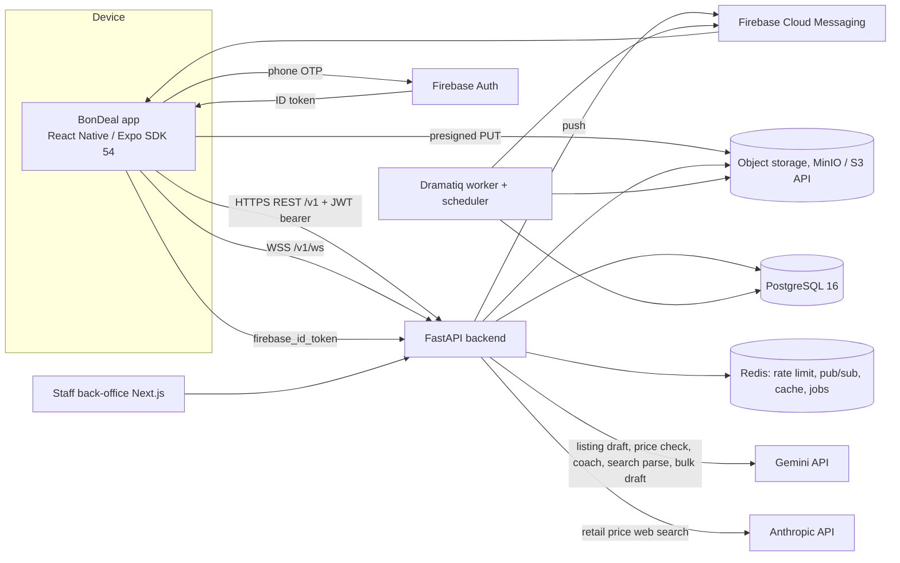
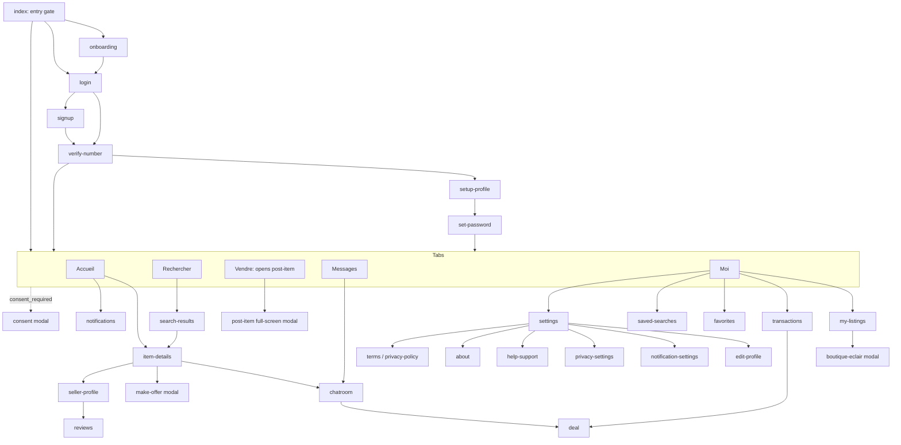
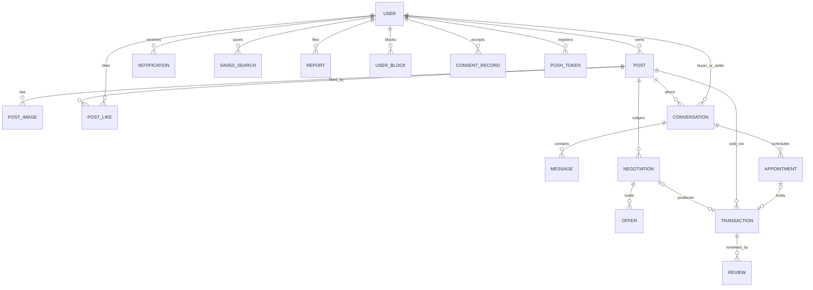
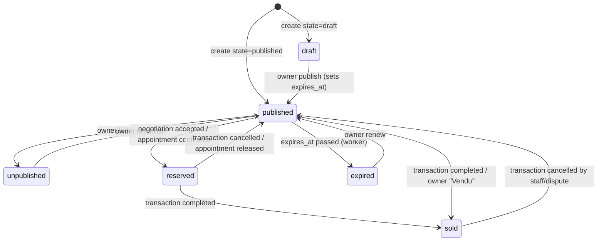
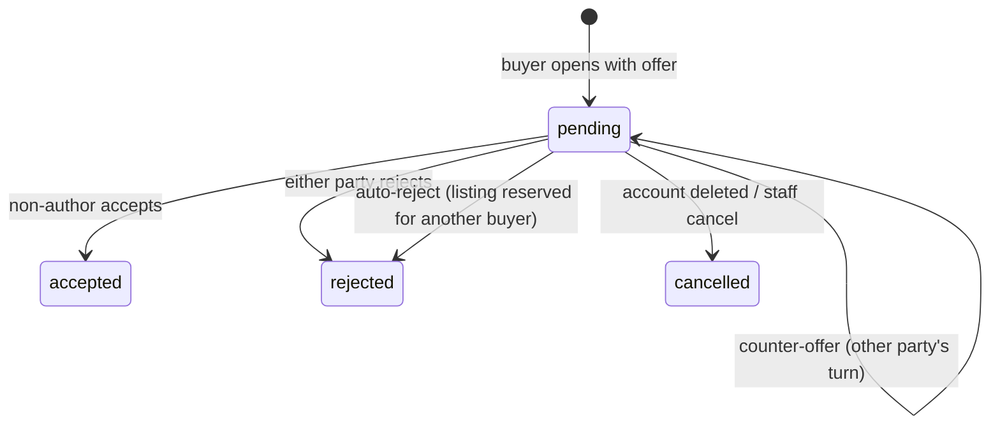
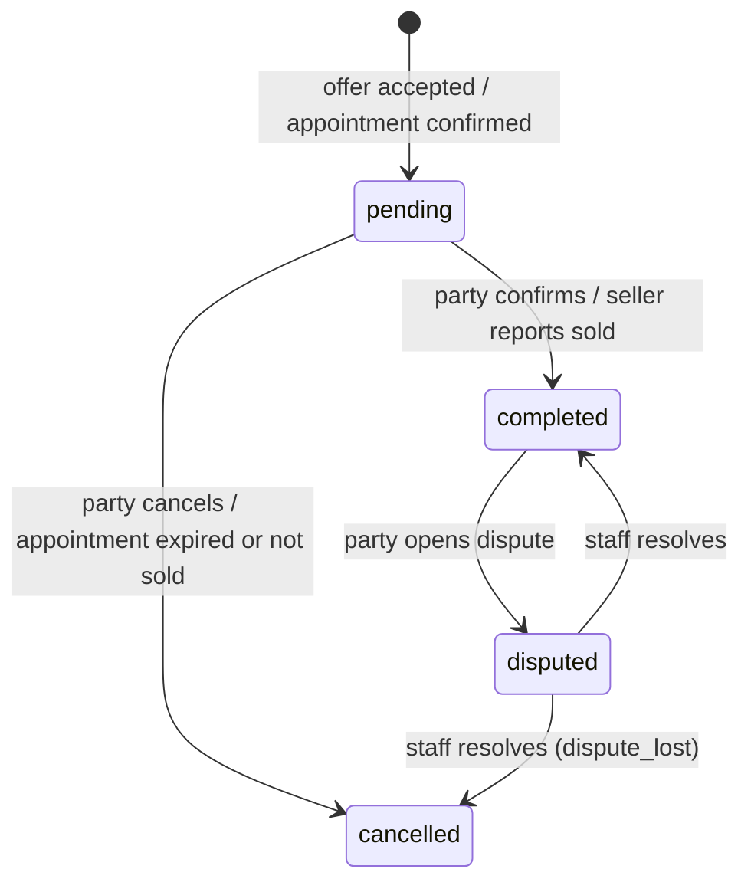
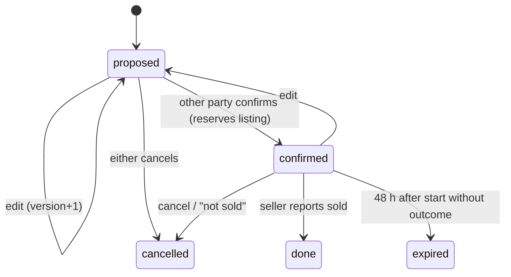

# Software Requirements Specification — BonDeal Mobile Application

| Item | Value |
| --- | --- |
| Product | BonDeal, second-hand marketplace for Gabon |
| Document | SRS (IEEE 830 / ISO/IEC/IEEE 29148 style) |
| Baseline | `bon-deal-rn` branch `ui-motion-redesign`; backend `bon-deal-fastapi` branch `mvp-completion` |
| App version | 1.0.0 (`app.config.js`) |
| Language of product | French (UI), English (this document) |
| Source of truth | Branch code. Where existing docs (Architecture.md, Backend.md, FRONTEND_MVP_ROADMAP.md, backend_api.md, ENVIRONMENT_SETUP.md) conflict with code, the code wins. |

Requirement ID format: `FR-<GROUP>-<NNN>`. Non-functional: `NFR-<GROUP>-<NNN>`. Interface: `IR-<GROUP>-<NNN>`. Data: `DR-<NNN>`. File paths in parentheses cite the code that fixes a rule. Paths starting with `backend/` or `main.py` are in `bon-deal-fastapi`; others are in `bon-deal-rn`.

---

## 1. Introduction

### 1.1 Purpose
This document specifies the functional and non-functional requirements of the BonDeal mobile application and the contract it relies on with the BonDeal backend. It is written from the implemented code so that it can drive testing, acceptance and alternative-client implementations.

### 1.2 Scope
BonDeal lets people in Gabon list, find, negotiate, arrange meetings for, and complete the sale of second-hand goods. The product comprises:

- the **mobile app** (React Native / Expo), specified here;
- the **FastAPI backend** (REST under `/v1`, WebSocket `/v1/ws`, workers), specified only where the app depends on it (business rules, limits, validation, contracts);
- a **staff back-office** (Next.js dashboard, `bon-deal-fastapi/frontend`), treated as an external actor and out of scope.

A **Flutter port** (`bon-deal-flutter`) is an alternative client implementing the same requirements. It is not specified separately; every requirement here applies to it.

Out of scope: in-app payments (the backend payments module is disabled, `main.py`), the staff dashboard, delivery/shipping, multi-language UI.

### 1.3 Definitions, acronyms, abbreviations

| Term | Meaning |
| --- | --- |
| FCFA / XAF | Central African CFA franc. Currency of all prices (`currency: "XAF"`). Displayed as `12 500 FCFA` with narrow no-break space grouping (`lib/format.ts`). |
| Quartier | Neighbourhood within a city; the unit of hyperlocal pickup and feed scoping. |
| Annonce | A listing (Post). |
| Boutique Éclair | Bulk-listing feature: 1–3 photos of many items produce up to 10 AI listing drafts (`app/boutique-eclair.tsx`, `POST /posts/bulk_draft`). |
| Négo-Coach / Coach IA | AI advice (hold / counter / accept) for the party whose turn it is in a negotiation (`POST /negotiations/{id}/coach`). |
| "Bon prix ?" ("C'est un bon prix ?") | Buyer-facing AI price verdict on a priced listing (`POST /posts/{id}/price_check`). |
| "Trouve-moi ça" | Natural-language search that the AI converts to filters (`POST /search/parse`). |
| Prix conseillé | Seller-facing suggested price range (`POST /posts/price_suggestion`). |
| Offre / Contre-offre | Offer / counter-offer inside a negotiation. |
| Affaire | The deal page for a transaction ("Votre achat" / "Votre vente"). |
| Rendez-vous | Appointment proposed from a chat; confirming it reserves the listing. |
| Litige | Dispute opened on a completed transaction. |
| OTP | One-time password sent by SMS through Firebase Auth. |
| FCM | Firebase Cloud Messaging (push). |
| JWT | JSON Web Token (HS256) issued by the backend. |
| Staff | Back-office personnel; never users of the mobile app. |
| Visitor | A person without an authenticated session. |

### 1.4 References
- `app.config.js`, `package.json`, `eas.json`, `app.json` (deprecated, superseded by `app.config.js`).
- `openapi/openapi.json`, `README.md`, `main.py`, `backend/core/config.py` in `bon-deal-fastapi`.
- Existing docs in this repo: `Architecture.md`, `Backend.md`, `FRONTEND_MVP_ROADMAP.md`, `backend_api.md`, `ENVIRONMENT_SETUP.md` (skimmed, verified against code).
- IEEE Std 830-1998; ISO/IEC/IEEE 29148:2018.

### 1.5 Overview
Section 2 describes the product context. Section 3 lists functional requirements by feature. Section 4 specifies external interfaces. Section 5 lists non-functional requirements. Section 6 defines data entities and state machines. Section 7 contains the traceability matrix and the open issues found while reading the code.

---

## 2. Overall Description

### 2.1 Product perspective

- The app is a client of the REST API versioned under `/v1`. The backend also mounts unprefixed legacy routes for installed apps (`main.py`).
- Realtime chat delivery uses an authenticated WebSocket; sending still uses REST (`backend/modules/messaging/ws.py`).
- Authentication is Firebase phone OTP exchanged for a backend JWT; phone+password sign-in is an alternative once a password has been set.
- Photos go directly from the device to object storage using presigned PUT URLs; a worker produces WebP variants.
- AI features run server-side: Gemini (`gemini-3.1-flash-lite`) for listing draft, bulk draft, price check, search parse, coach and meetup suggestion; Anthropic (`claude-haiku-4-5`) with web search for a retail-price reference in price suggestion (`backend/modules/ai/service.py`).
- Staff (moderation, disputes, reports, geo data, settings, deletion requests) act only through the back-office.

### 2.2 Product functions (summary)
1. Onboarding, authentication (SMS OTP, password), legal consent gate.
2. Profile, settings, preferences, data export, account deletion, blocked users.
3. Feed with city / quartier / near-me scopes, categories, quick filters, likes, resume-draft card.
4. Search: text, suggestions, recents, trending, natural-language, filters, sort, saved searches with alerts.
5. Listing details: gallery, AI price check, seller card, similar items, share, report.
6. Selling: 3-step flow, direct photo uploads, AI draft and price suggestion, autosave, publish, edit, renew, Boutique Éclair, listing management.
7. Favorites.
8. Messaging with realtime delivery, unread counts, local archive, quick replies, safety banner, system messages.
9. Negotiation (offers, counters, accept/reject) and Négo-Coach.
10. Appointments and meeting places.
11. Deals (transactions): timeline, confirm, cancel, dispute, reviews.
12. Seller profiles and reviews.
13. Notifications (in-app list, push, deep links).
14. Trust and safety: reports, blocks, moderation effects.
15. App status (maintenance, forced and soft update, offline banner).
16. Opt-in analytics.

### 2.3 User classes

| Class | Description | Capabilities |
| --- | --- | --- |
| Visitor | No session. Sees onboarding, login, signup, legal text. | Read legal pages; start sign-in. The app does not offer anonymous browsing: tabs require a session (`app/index.tsx`, `contexts/AuthContext.tsx`). Chat, notifications show a "Connectez-vous" empty state when unauthenticated. |
| Buyer | Authenticated user acting on another user's listing. | Browse, search, like, contact, make offers, meet, complete deals, review, report, block. |
| Seller | Authenticated user owning listings. | Create, edit, renew, hide, mark sold, delete listings; answer offers; propose appointments; complete deals. |
| Staff (external actor) | Back-office accounts. | Moderate listings and photos, handle reports, resolve disputes, manage geo data, platform settings, deletion requests. Staff sessions cannot use the mobile app (`backend/modules/identity/auth.py`: "Les sessions d'équipe ne peuvent pas utiliser l'application"). |

Buyer and Seller are roles of one account, not separate account types (`User.role = "user"`).

### 2.4 Operating environment
- **iOS**: deployment target 15.1 (`ios/Podfile`), iPhone and iPad (`supportsTablet: true`), portrait orientation.
- **Android**: Expo SDK 54 defaults (minSdk 24), compile SDK 36, build-tools 36.0.0, edge-to-edge enabled, predictive back disabled (`app.config.js`).
- **Framework**: Expo SDK 54 (`expo ~54.0.13`), React Native 0.81.4, React 19.1.0, New Architecture enabled, Expo Router 6, TanStack Query 5, Reanimated 4, React Native Firebase 23.
- **Development client required**: native modules (Firebase, haptics, file system) need a dev client or standalone build; Expo Go is not sufficient (`lib/push.ts`, `lib/haptics.ts` degrade to no-ops when native modules are absent).
- **Web**: `react-native-web` and static output are configured, but Firebase Auth and Messaging are native-only, so web is **not a supported target** (see Open issues OI-14).
- **Backend**: Python 3.12, FastAPI, PostgreSQL 16, Redis, MinIO, Dramatiq (`README.md`).

### 2.5 Design and implementation constraints
- C-1: All user-visible text is French. Server error `detail` strings are French; clients branch on `X-Error-Code`, not on text (`backend/core/errors.py`).
- C-2: Prices are integers in FCFA in the UI; the backend stores a float.
- C-3: Production builds shall forbid cleartext HTTP; local and test builds may allow it (`usesCleartextTraffic` in `app.config.js`).
- C-4: The app shall work with the access token lifetime of 15 minutes.
- C-5: Native Firebase modules require `google-services.json` / `GoogleService-Info.plist` per build.
- C-6: Listing categories, conditions, age buckets and states are fixed enums shared with the backend (`constants/catalog.ts`).
- C-7: Third-party AI providers are only reached by the backend; the app never holds AI keys.
- C-8: The backend generated schema `lib/api/schema.d.ts` is derived from `openapi/openapi.json`.

### 2.6 Assumptions and dependencies
- A-1: Users have an SMS-capable Gabonese or foreign number; the default country comes from `/app-config` (`default_country`, Gabon `GA`, `+241`).
- A-2: Firebase phone auth is configured in production. Without it `POST /auth/firebase` answers 503 `phone_auth_unavailable`.
- A-3: Redis is available; rate limiting fails open if Redis is unreachable (`backend/core/rate_limit.py`).
- A-4: Object storage is publicly readable for variants and accepts presigned PUT.
- A-5: Cities and quartiers are curated by staff; only enabled cities of enabled countries are selectable.
- A-6: Gabon time is UTC+1 all year (used for appointment reminders, `backend/modules/trade/appointments.py`).

---

## 3. Functional Requirements

Notation: "the app" is the mobile client; "the backend" is the FastAPI service. Limits are quoted from code.

### 3.1 Onboarding and entry gate (ONB)

| ID | Requirement | Acceptance / source |
| --- | --- | --- |
| FR-ONB-001 | On cold start the app shall show an animated splash overlay (minimum 600 ms) above the app until fonts are loaded. | `app/_layout.tsx` |
| FR-ONB-002 | The entry route shall redirect to `/(tabs)/home` when a cached JWT exists, to `/onboarding` when the onboarding flag `bondeal.onboarding.seen` is not `1`, otherwise to `/login`. | `app/index.tsx`. The decision uses the cached JWT, not the profile, so an offline cold start does not bounce a signed-in user. |
| FR-ONB-003 | Onboarding shall present 3 slides: "Les bonnes affaires de votre quartier", "Votre annonce en 30 secondes", "Échangez en sécurité" (body: "Ne perdez pas votre argent : ne payez jamais d'avance, même un acompte."). | `app/onboarding.tsx` |
| FR-ONB-004 | Onboarding shall offer "Passer" and, on the last slide, "Commencer"; both shall set the seen flag and navigate to `/login`. | Slides announce "Étape i sur 3". |
| FR-ONB-005 | The app shall provide a global gate (AppGate) over the navigation stack for maintenance and update states (see 3.15). | `components/organisms/AppGate.tsx` |

### 3.2 Authentication and session (AUTH)

| ID | Requirement | Acceptance / source |
| --- | --- | --- |
| FR-AUTH-001 | The login screen ("Bon retour !") shall offer phone-OTP sign-in ("Recevoir le code") and, as a toggle, phone+password sign-in ("Se connecter avec un mot de passe" / "Recevoir plutôt un code par SMS"), plus "Créer un compte". | `app/login.tsx` |
| FR-AUTH-002 | The phone form shall include a country picker defaulting to the platform default country from `/app-config` and restricted to enabled countries (full list when only one is enabled), a national-number field (placeholder "06 12 34 56") and shall require at least 6 digits before submission. | `components/organisms/AuthPhoneForm.tsx`; number parsed with libphonenumber-js to E.164. |
| FR-AUTH-003 | Signup ("Rejoignez BonDeal") shall collect only the phone number, show links to terms and privacy policy, then continue to code verification. | `app/signup.tsx` |
| FR-AUTH-004 | The app shall send the SMS code through Firebase Auth phone verification and show the verification screen ("Entrez le code") with a 6-digit input and a "Vérifier" button enabled only when 6 digits are entered. | `app/verify-number.tsx` |
| FR-AUTH-005 | "Renvoyer" shall be disabled for 30 s after each send ("Renvoyer dans N s"). | `RESEND_COOLDOWN_S = 30` |
| FR-AUTH-006 | A wrong code shall show "Code incorrect. Vérifiez le SMS et réessayez.", shake the input and play an error haptic; an expired code, an expired session, too many attempts, SMS quota and no connectivity shall each have a distinct French message; offline failure shall keep the typed code and not signal it as wrong. | `app/verify-number.tsx` |
| FR-AUTH-007 | After a successful code check: in login mode go to `/(tabs)/home`; in signup mode go to `/setup-profile`. | |
| FR-AUTH-008 | After Firebase sign-in the app shall exchange the Firebase ID token for a backend JWT with `POST /auth/firebase {firebase_id_token}`. The backend shall verify the token, find or create the user by phone number (username `user<last 6 digits>`, de-duplicated), mark it verified, refuse banned accounts (403 `account_banned`), and answer `{access_token, token_type, expires_in: 900}`. | `backend/modules/identity/auth.py`. Rate limit 20/min per IP. |
| FR-AUTH-009 | The access token shall be stored in secure storage (`expo-secure-store`, key `bondeal.jwt`); a read or write failure shall never be fatal. | `lib/auth-storage.ts` |
| FR-AUTH-010 | The API client shall attach `Authorization: Bearer <jwt>` and `X-App-Version` to every request. | `lib/api.ts` |
| FR-AUTH-011 | On HTTP 401 (except for refresh calls) the API client shall call the registered refresh handler once, share one refresh among concurrent 401s, and retry the original request once. | `lib/api.ts` |
| FR-AUTH-012 | The refresh handler shall, in order of precedence: (a) when a stored refresh token exists, call `POST /auth/token/refresh`; (b) in a dev-login session, repeat the dev exchange; (c) otherwise force-refresh the Firebase ID token and call `/auth/firebase`. A 401/403 on token refresh shall end the session; a network failure shall keep it. | `contexts/AuthContext.tsx` |
| FR-AUTH-013 | Phone+password login shall call `POST /auth/login/phone {phone_number, password}` and receive `{access_token, refresh_token, expires_in}`; the refresh token (30 days, sliding) shall be stored in secure storage (`bondeal.refreshToken`). | `MOBILE_REFRESH_TOKEN_EXPIRE_DAYS = 30` |
| FR-AUTH-014 | The backend shall answer identically for unknown number, number without a chosen password, and wrong password (401 `invalid_credentials`), and shall lock the number after 10 failures in 15 minutes (429 `too_many_attempts`). Login is also limited to 10/min per IP. | The app maps: "Numéro ou mot de passe incorrect.", "Trop de tentatives. Réessayez dans 15 minutes ou connectez-vous par SMS.", "Votre compte a été suspendu." |
| FR-AUTH-015 | `POST /auth/token/refresh` shall reject a refresh token issued before the current password was set (401 `session_expired`), a wrong token type (401 `session_invalid`), deleted users and banned users. | Limit 30/min. |
| FR-AUTH-016 | A password session shall restore from the cached JWT at start; if absent it shall renew through the refresh token. | `AuthContext` |
| FR-AUTH-017 | In non-production builds with `DEV_OTP_ENABLED`, the app may offer a local test login (`POST /auth/dev-otp`, one configured number and fixed code). The backend shall answer 404 when disabled. This shall never be enabled in production. | `app.config.js`: `devOtpEnabled` forced false when `APP_ENV=production`; `backend/core/config.py`. |
| FR-AUTH-018 | Sign-out shall unregister the device push token (best effort, 3 s cap), clear JWT, refresh token and dev phone, and sign out of Firebase. | `contexts/AuthContext.tsx` |
| FR-AUTH-019 | After sign-in the app shall load `GET /auth/me` (profile, `consent_required`, preferences) and register the push token. | `loadMe` |
| FR-AUTH-020 | A banned user shall be refused at every sign-in path and on every authenticated request. | 403 `account_banned`. |

#### 3.2.1 Profile setup (first run)

| ID | Requirement | Acceptance / source |
| --- | --- | --- |
| FR-AUTH-021 | After signup the setup-profile screen shall require a nickname of 2 to 30 characters and a city; quartier and avatar shall be optional. | `app/setup-profile.tsx`; messages "Au moins 2 caractères", "30 caractères maximum". |
| FR-AUTH-022 | The nickname shall be saved as both `username` and `first_name` via `PATCH /auth/me`, with `city` and `quartier`. An unknown or disabled city shall be refused (400 "Cette ville n'est pas disponible sur BonDeal") and shown as "Ville indisponible". | `backend/modules/identity/auth.py` |
| FR-AUTH-023 | After the profile, the app shall offer password creation ("Choisissez un mot de passe") with "Plus tard" to skip. | `app/set-password.tsx` |
| FR-AUTH-024 | Password rules, enforced identically client and server: at least 8 characters, ASCII letters and digits only, at least one letter and one digit, confirmation equal. The screen shall display a live checklist ("Au moins 8 caractères", "Au moins une lettre", "Au moins un chiffre", "Lettres et chiffres uniquement", "Les deux mots de passe sont identiques"). | `password_policy` in `backend/modules/identity/auth.py` |
| FR-AUTH-025 | `PUT /auth/me/password` shall accept the new password without the current one only when the session was opened with the phone code (`amr: otp`); otherwise it shall require `current_password` (400 `current_password_required` / `current_password_invalid`). Setting a password shall end other password sessions. Limit 10/hour per user. | |

### 3.3 Legal consent gate (CONS)

| ID | Requirement | Acceptance / source |
| --- | --- | --- |
| FR-CONS-001 | `GET /auth/me` shall include `consent_required`, the list of documents (`terms`, `privacy`) whose current version the user has not accepted. | `backend/modules/identity/account.py` |
| FR-CONS-002 | When `consent_required` is non-empty the tabs layout shall redirect to `/consent` (modal, back gesture disabled). | `app/(tabs)/_layout.tsx` |
| FR-CONS-003 | The consent screen shall show the current document versions (`GET /legal`), links to the terms and the privacy policy, a mandatory checkbox "J'ai lu et j'accepte les conditions d'utilisation et la politique de confidentialité de BonDeal.", the primary action "Accepter et continuer", and "Refuser et me déconnecter". Title: "Bienvenue sur BonDeal" for first acceptance, "Nos conditions évoluent" for updates. | `app/consent.tsx` |
| FR-CONS-004 | Acceptance shall call `POST /auth/me/consents {documents}`; the backend shall record a ConsentRecord per document with the current version. Default versions are `2026-10-19` and are staff-editable. | `PlatformSettings.terms_version/privacy_version` |
| FR-CONS-005 | The terms and privacy policy shall be available as in-app screens reachable from signup, consent and settings. | `app/terms-and-conditions.tsx`, `app/privacy-policy.tsx` (static text) |

### 3.4 Profile and settings (PRF)

| ID | Requirement | Acceptance / source |
| --- | --- | --- |
| FR-PRF-001 | The Moi tab shall show avatar, display name, rating, sales and online-listing counts, a profile-completion card with the next missing step (name, quartier, photo, password), and entries: Mes annonces, Achats et ventes, Favoris, Mes recherches, Modifier le profil, Mes avis, Notifications, Paramètres, Aide & Support, À propos. | `app/(tabs)/profile.tsx` |
| FR-PRF-002 | Edit profile shall allow first name (max 60), last name (max 60), e-mail (client regex validation, message "Adresse e-mail invalide (ex. nom@exemple.com)"), city/quartier via the location picker, and avatar. Phone number shall be read-only. Unsaved changes shall prompt "Quitter sans enregistrer ?". | `app/edit-profile.tsx` |
| FR-PRF-003 | `PATCH /auth/me` shall validate: phone E.164 (`+` and 8–15 digits), date of birth `YYYY-MM-DD` (not future, not older than 120 years), gender in `male|female|other`, e-mail format; duplicates shall give 409 `email_taken`, `phone_taken` or `username_taken`. | `backend/core/validators.py` |
| FR-PRF-004 | Avatar upload shall use `POST /auth/me/avatar` (multipart), limited to 20/hour per user, from camera (with permission prompt) or library. | |
| FR-PRF-005 | Location choice shall be hierarchical: country (only if more than one enabled), city, optional quartier ("Toute la ville" allowed), with search fields ("Rechercher un pays/une ville/un quartier"). | `components/organisms/LocationPickerSheet.tsx`; geo lists cached 30 min. |
| FR-PRF-006 | Settings shall offer theme selection (system, light, dark) persisted locally under `bondeal.theme.preference`. | `theme/index.tsx` |
| FR-PRF-007 | Notification settings shall expose server-stored switches: messages, offers, listings (expiry), saved_searches, marketing (default off), plus a link to phone notification permissions. Switches shall update optimistically and roll back with the toast "Réglage non enregistré" on failure. | `app/notification-settings.tsx`, `lib/usePreferences.ts`; `PUT /auth/me/preferences` |
| FR-PRF-008 | Privacy settings shall expose: "Afficher mon nom complet" (`show_last_name`, default off), "Afficher mon quartier" (`show_quartier`, default on), "Partager des statistiques d'utilisation" (`analytics`, default off). | `app/privacy-settings.tsx`; backend `PRIVACY_DEFAULTS` |
| FR-PRF-009 | Push for a notification type shall be sent only when the matching category switch is on; types without a category (e.g. `staff_warning`) are always pushed. | `PUSH_CATEGORY`, `push_allowed` |
| FR-PRF-010 | "Télécharger mes données" shall call `POST /auth/me/export-link` (limit 5/hour) and open the returned 10-minute link in the browser; the download is a JSON file `bondeal-donnees-YYYYMMDD.json` with profile, listings, messages, transactions, reviews and consents. Rate-limit error shows "Trop de demandes. Réessayez dans une heure." | |
| FR-PRF-011 | Account deletion shall require typing `SUPPRIMER` (case-insensitive on the client; exact on the server) in a confirmation sheet, which also offers "Télécharger mes données avant". `DELETE /auth/me {confirm}` shall anonymise the user (username `supprime-<id>`, personal fields null, phone freed), unpublish and empty their listings, delete their photos asynchronously, cancel pending negotiations (`account_deleted`), and delete likes, views, push tokens, notifications, consents and blocks. Conversations and transactions remain visible to the other party. | `anonymize_user`; the app then signs out locally. |
| FR-PRF-012 | A public web page `/v1/account-deletion` shall let a person request deletion without the app; staff process it. | `backend/modules/identity/deletion_page.py` |
| FR-PRF-013 | Blocked members shall be listed under Confidentialité with a "Débloquer" action. | `GET /users/me/blocks` |
| FR-PRF-014 | Help & Support shall present a FAQ and community rules as accordions and a support contact; About shall show version, environment (dev only) and open-source licences. | `app/help-support.tsx`, `app/about.tsx` |
| FR-PRF-015 | The app shall display the public profile of any member with display name, avatar, city, quartier (if allowed), member-since date, phone-verified flag, rating, review count, sales count, active listings, median response time, and `blocked_by_me`. Last name is shown as an initial plus "." unless `show_last_name`. | `GET /users/{id}/profile` |

### 3.5 Home feed (HOME)

| ID | Requirement | Acceptance / source |
| --- | --- | --- |
| FR-HOME-001 | Home shall show: location chip, notification bell with unread count, search bar with an AI shortcut, a carousel of the newest listings with a photo in scope, category mosaic, quick filters and an infinite masonry feed. | `app/(tabs)/home.tsx` |
| FR-HOME-002 | Feed requests shall be `GET /posts?page=N&limit=20`; the backend shall return only `published`, approved (or own) listings in the caller's city, excluding blocked users. | `PAGE_SIZE = 20` |
| FR-HOME-003 | The scope sheet "Zone des annonces" shall offer "Toute la ville", the user's quartier (disabled until a quartier is set) and "Près de moi". | `HomeScopeSheet.tsx` |
| FR-HOME-004 | Quartier scope shall filter by exact `quartier=<name>`. Near-me shall request the device position once, on demand, and call the feed with `near_lat`, `near_lng`, `radius_km=5` and `sort=distance`; rows then carry `distance_km`. | `NEAR_RADIUS_KM = 5`; backend caps `radius_km` at 200 |
| FR-HOME-005 | Position acquisition shall request foreground permission only when the user taps, use balanced accuracy with a 10 s timeout, fall back to the last known fix up to 30 minutes old, and show "Position non autorisée" / "Position introuvable" on failure. Coordinates are rounded to 3 decimals (~100 m). | `lib/location.ts` |
| FR-HOME-006 | Quick filters: "Récent" (default), "Moins de 50 000 F" (`max_price=50000`) and "Gratuit" (`is_free=true`). | `CHEAP_MAX_PRICE = 50_000` |
| FR-HOME-007 | Six categories shall be inline (Électronique, Mode, Meubles, Véhicules, Électroménager, Bébé & Enfants); the rest via "Plus". Category choice opens search results filtered on that category. | `TOP_CATEGORIES` |
| FR-HOME-008 | Empty states shall be scope-specific (e.g. "Aucune annonce dans votre ville", "Rien près de vous") with a recovery action. | |
| FR-HOME-009 | Liking a listing shall be optimistic (`POST/DELETE /posts/{id}/like`); a 400 (already liked / not liked) shall be treated as already in the desired state. | `lib/api/posts.ts` |
| FR-HOME-010 | If a local sell draft exists, Home shall show a resume card ("Terminer votre annonce", step N sur 3, relative time, progress), dismissible by swipe or close button for the session without deleting the draft. | `lib/sellDraft.ts` |
| FR-HOME-011 | "Voir tout" shall open search results with `sort=date_new` and the current scope parameters. | |

### 3.6 Search (SRCH)

| ID | Requirement | Acceptance / source |
| --- | --- | --- |
| FR-SRCH-001 | The Rechercher tab (and the pushed `/search` screen kept for old links) shall show: search field, recent searches as chips, the "Trouve-moi ça" card, "Tendances à <ville>", and category tiles (TOP_CATEGORIES plus Sports). | `components/organisms/SearchPanel.tsx` |
| FR-SRCH-002 | Recent searches shall be stored on the device (`@bondeal_recent_searches`), most recent first, de-duplicated, at most 10, clearable. | |
| FR-SRCH-003 | While typing, the panel shall show matching recents (max 5), server title suggestions and matching categories (max 4). Suggestions call `GET /search/suggest?q=` for 2 to 60 characters; the backend returns up to 8 distinct titles of approved published listings in the caller's city, newest first. Cached 60 s. | `backend/modules/catalog/saved_searches.py` |
| FR-SRCH-004 | Trending shall call `GET /search/trending?city=&limit=` (default 5, 1–10), a 7-day window, only terms searched by at least 3 distinct users, 2–60 characters, excluding terms that look private (phone-like); cached 10 minutes server-side and client-side. The section is hidden when empty or failing. | `backend/modules/catalog/trending.py` |
| FR-SRCH-005 | Natural-language search ("Trouve-moi ça") shall send the utterance (1–300 characters) to `POST /search/parse` and navigate to results with the returned `search`, `categories` (max 3), `condition`, `min_price`, `max_price`, `sort` when present. An inverted price range is dropped. Failures: 429 "Limite atteinte, réessayez plus tard.", 502/503 "Recherche intelligente indisponible.". | AI rate limit in 3.17 |
| FR-SRCH-006 | Results shall be fetched with `GET /posts` supporting: `search`, `categories`, `min_price`, `max_price`, `condition` (comma list), `quartier`, `is_free`, `near_lat/near_lng/radius_km`, `sort` (JSON `[{"id": "...", "desc": bool}]`), `page`, `limit=20`. | |
| FR-SRCH-007 | Text search shall be French full-text, accent-insensitive and stemmed, with prefix matching and a title substring match; results without explicit sort are ranked by relevance. | `_posts_query` |
| FR-SRCH-008 | Sort options shall be: "Récents" (default), "Prix croissant", "Prix décroissant", and "Distance" (only when a position is set; otherwise falls back to "Récents"). | `app/search-results.tsx` |
| FR-SRCH-009 | The filter sheet shall offer: category, price buckets ("Moins de 50 000 FCFA", "50 000 – 100 000 FCFA", "Plus de 100 000 FCFA"), condition modes ("Tous états" = no filter, "Comme neuf" = `excellent`, "Occasion" = `good,fair,poor`), quartier chips (12 shown, search for the rest), near-me with radius choices 2, 5, 10 and 25 km (default 5), a live "Voir N résultat(s)" count, and reset. Active filters shall appear as removable chips. | |
| FR-SRCH-010 | Each text search shall be logged server-side (query truncated to 300 characters, city, result count) for trending; the log shall be purged after 30 days. | `_log_search`, `SEARCH_QUERY_RETENTION_DAYS` |
| FR-SRCH-011 | Saving a search ("Enregistrer cette recherche") shall take a name (1–80 characters) and an alerts switch (default on) and call `POST /saved-searches {name, filters, alerts_enabled}`. Filters: `search` ≤120 chars, `categories` ≤10, `min_price`/`max_price` ≥0, `condition`, `quartier`, `near_lat/near_lng`, `radius_km` ≤200. | `SaveSearchSheet.tsx` |
| FR-SRCH-012 | A user shall have at most 20 saved searches; beyond that the backend answers 400 `saved_search_limit`. | `MAX_SAVED_SEARCHES = 20` |
| FR-SRCH-013 | "Mes recherches" shall list saved searches with replay on tap, alert switch (optimistic), rename, and delete with a 5 s undo toast. | `app/saved-searches.tsx` |
| FR-SRCH-014 | A scheduled job every 15 minutes shall, for each alert-enabled saved search of an active user, find listings created or approved since `last_checked_at` (max 20) and create one `saved_search_match` notification carrying `count`, first `post_id`, `saved_search_id`. | `check_saved_searches` |
| FR-SRCH-015 | Tapping a `saved_search_match` shall open the post when `count == 1`, else replay the saved search, else open the saved-search list. | `lib/notificationTarget.ts` |

### 3.7 Listing details (ITEM)

| ID | Requirement | Acceptance / source |
| --- | --- | --- |
| FR-ITEM-001 | The detail page shall load `GET /posts/{id}`; the backend shall hide non-approved listings from non-owners (404 "Annonce introuvable") and record one unique view per user. | `app/item-details.tsx` |
| FR-ITEM-002 | The gallery shall show the large variant of each ready photo, a counter "i/n", a full-screen viewer, double-tap 2x zoom, and the label "Photo i sur n". The card cover shall fly into the hero photo unless reduce motion is on. | `components/organisms/ItemGallery.tsx` |
| FR-ITEM-003 | The page shall display title, price (or "Gratuit"), badges ("Négociable", "Gratuit", "Échange possible"), state badge for non-published states ("Vendu", "Réservé", "Brouillon", "Masquée"), counts (views, likes, offers), condition, age, pickup place ("Retrait"), publication date, and a collapsible description ("Voir plus"/"Voir moins"). | |
| FR-ITEM-004 | The seller card shall show name, verified-phone shield, rating and review count, sales count and "répond en ~X" when known, and open the seller profile. | `SellerCard.tsx` |
| FR-ITEM-005 | "C'est un bon prix ?" shall be offered for non-free priced listings and call `POST /posts/{id}/price_check`; it shall show the verdict (`bonne_affaire`, `prix_correct`, `trop_cher`), rationale, condition flags, market range, and confidence. Errors: 503 "L'assistant prix n'est pas disponible pour le moment.", 429 "Trop de vérifications — réessayez plus tard.", 409 "Cette annonce n'a pas de prix à vérifier.". | See 3.17 for the verdict rules. |
| FR-ITEM-006 | Similar listings shall be derived from the first category: feed page 1 of that category, excluding the current listing, only `published`, at most 10, shown in a horizontal list titled "Annonces similaires". | |
| FR-ITEM-007 | Share shall use the native share sheet with the message `<title> — <price> sur BonDeal` and an app deep link (`bondeal://item-details?id=`); after a completed share the app shall call `POST /posts/{id}/share` (fire-and-forget counter) and track `share_item`. | |
| FR-ITEM-008 | "Signaler cette annonce" shall open the report sheet for non-owners (see 3.14). | |
| FR-ITEM-009 | The action dock for non-owners of an available listing shall show "Contacter" (open or create the conversation, `POST /conversations {post_id}`) and, when `allow_negotiation` and not free, "Faire une offre"; the dock shall display "Ne payez jamais d'avance. Remise en main propre." | `ActionDock.tsx` |
| FR-ITEM-010 | For the owner the dock shall show "Mes annonces" and "Modifier". | |
| FR-ITEM-011 | Reserved listings shall tell the viewer: "Réservée pour vous." (holder), "Réservé — vous serez prévenu s'il se libère." (liked or chatted) or "Réservé — aimez l'annonce pour être prévenu s'il se libère."; sold or unavailable: "Cette annonce est vendue." / "Cette annonce n'est plus disponible.". | `PostDetailOut.reservation` |
| FR-ITEM-012 | Contacting or offering across a block shall show the server message "Vous ne pouvez pas contacter cet utilisateur." (403 `user_blocked`). | |
| FR-ITEM-013 | Contacting one's own listing shall be refused (400 "Vous ne pouvez pas démarrer une conversation avec vous-même"). | |

### 3.8 Selling (SELL)

#### 3.8.1 Flow and validation

| ID | Requirement | Acceptance / source |
| --- | --- | --- |
| FR-SELL-001 | The centre "Vendre" tab button shall open `/post-item` as a full-screen modal (gesture-back disabled); `/(tabs)/sell` only redirects. | `app/(tabs)/_layout.tsx`, `sell.tsx` |
| FR-SELL-002 | Creation shall be a 3-step flow: "Photos", "Vérifier", "Aperçu". Edit mode (`/post-item?id=&mode=edit`) reuses the same steps without autosave. | `app/post-item.tsx` |
| FR-SELL-003 | Step 1 shall require at least one photo ("Ajoutez au moins une photo"). The maximum number of photos shall be the `max_images` from `/app-config` (platform default 5; client fallback 5), message "Maximum N photos.". | `DEFAULT_MAX_PHOTOS = 5` |
| FR-SELL-004 | Photos shall be picked one at a time from camera or library with permission prompts, 4:3 crop, quality 0.8; the first photo is the cover ("Couverture"); photos may be reordered and removed. | |
| FR-SELL-005 | Step 2 shall require: title (max 80 chars, with counter), description, category (single selection), condition ("Excellent état", "Bon état", "État correct", "À réparer"), price when listing type is "Vendre" (digits only), "Contre quoi ?" when "Échanger". Optional: age ("Moins de 6 mois", "6 mois – 2 ans", "2 – 5 ans", "Plus de 5 ans"), negotiable switch (default on, only for "Vendre"), pickup quartier (defaults to the user's quartier), meeting note ("Point de rencontre (optionnel)"). | Error strings: "Le titre est requis", "La description est requise", "La catégorie est requise", "L'état est requis", "Le prix est requis", "Précisez contre quoi échanger". |
| FR-SELL-006 | Listing types shall be "Vendre", "Donner" (`is_free=true`, no price), "Échanger" (`exchange_items` set). | |
| FR-SELL-007 | Step 3 shall preview the buyer's card and a summary list (photos, category, condition, price, quartier) and offer "Publier" and "Brouillon". | |
| FR-SELL-008 | Publishing shall send `POST /posts` as multipart with `state=published` (or `draft`), fields `title`, `description`, `price`, `is_free`, `exchange_items`, `allow_negotiation`, `categories` (CSV), `condition`, `age_bucket`, `pickup_quartier`, `pickup_location_note`, optional `lat`/`lng` and `image_keys` (CSV). | `backend/modules/catalog/posts.py` |
| FR-SELL-009 | The backend shall reject more photos than `max_images` (400 `photo_limit`: "Une annonce peut avoir au plus N photos"). | |
| FR-SELL-010 | If no `lat/lng` is supplied, the backend shall place the listing at the pickup quartier centre when known. | `_default_location` |
| FR-SELL-011 | Published listings shall get `expires_at = now + listing_expiry_days` (platform setting, default 30). | |
| FR-SELL-012 | The backend shall return `possible_duplicate_of` when the same owner has an active listing with the same trimmed, case-insensitive title created in the last 30 days; the app shall warn but not block. | `_possible_duplicate` |
| FR-SELL-013 | Categories shall be 0–3 of: `electronics`, `furniture`, `appliances`, `vehicles`, `fashion`, `baby_kids`, `sports`, `books`, `tools`, `other` (DB check). The app sends exactly one. | |
| FR-SELL-014 | On success the app shall clear the local draft, play a success haptic and show a celebration with a share action. A draft save shows "Brouillon enregistré — Retrouvez-le dans « Mes annonces »." | `SellCelebration.tsx` |

#### 3.8.2 Photos

| ID | Requirement | Acceptance / source |
| --- | --- | --- |
| FR-SELL-020 | Each picked photo shall be uploaded as soon as it is picked: `POST /uploads/presign {content_type, size}` then HTTP PUT of the bytes to the returned URL with the returned headers, with progress. | `lib/api/uploads.ts` |
| FR-SELL-021 | Accepted types are `image/jpeg`, `image/png`, `image/webp`; the original shall be at most 10 MiB (client message "Photo trop lourde (10 Mo maximum)"); presign validity is 10 minutes; limit 120 presigns/hour/user. Direct upload unavailable gives 503 `direct_upload_unavailable`. | `backend/modules/catalog/media.py` |
| FR-SELL-022 | Per-photo states "uploading", "done", "error" shall be shown with retry; publishing shall be blocked while uploads are pending or failed. | |
| FR-SELL-023 | Attaching keys shall create PostImage rows in status `processing`; a worker shall validate the image, apply EXIF rotation, strip metadata, write WebP variants `thumb` 320 px, `medium` 800 px, `large` 1600 px (quality 80, immutable cache headers) and mark the image `ready`; invalid files become `failed` and are removed. | `process_image` |
| FR-SELL-024 | Non-owners shall see only `ready` images; owners also see `processing`/`failed`. In edit mode the app shall poll every 2 s while any image is `processing`. | `serialize_post` |
| FR-SELL-025 | In edit mode a new photo shall be attached with `POST /posts/{id}/images {keys}` (1–20 keys, still bounded by `max_images`); a removed photo shall use `DELETE /posts/{id}/images/{image_id}`. | |
| FR-SELL-026 | Unattached uploads under `incoming/` shall be purged after 24 hours. | `purge_incoming_uploads` |
| FR-SELL-027 | The app shall pick the smallest adequate variant: thumbnail in lists, large in the gallery, falling back to `url` for legacy photos. | `lib/images.ts` |

#### 3.8.3 AI assistance

| ID | Requirement | Acceptance / source |
| --- | --- | --- |
| FR-SELL-030 | When the user reaches step 2 with photos and an empty title (create mode), the app shall automatically request an AI draft once: upload the photos with the legacy `POST /upload` (multipart) to obtain URLs, then `POST /posts/ai_draft {image_urls (1–10), hint_title ≤200}`. The result fills empty title/description/category only. | `app/post-item.tsx`, `lib/api/ai.ts` |
| FR-SELL-031 | The backend shall return `{categories (≤3 from the enum, default "other"), title ≤100, description ≤500, confidence 0–1}` with phone/URL-like text stripped; failures give 502 `ai_failed`; no readable image gives 400. | `ai_draft` |
| FR-SELL-032 | The price suggestion shall be requested on step 2 once a title and category exist, and again when category, condition or age change: `POST /posts/price_suggestion {categories 1–3, title 1–200, condition?, age_bucket?}`. | |
| FR-SELL-033 | The backend shall compute: tier 1 "similar_items" (comparable listings; suggested, range_min, range_max, comparable_count; scaled by condition multiplier); tier 2 "depreciation_curve" (web-searched retail price in XAF × category/age factor × condition multiplier, range ±15 %); tier 3 "no_data" with message "Pas de référence trouvée — saisissez votre prix.". Condition multipliers: excellent 1.10, good 1.00, fair 0.75, poor 0.50. | `backend/modules/ai/service.py` |
| FR-SELL-034 | The UI shall show the suggested range with one-tap presets and shall leave the final price to the seller. | |

#### 3.8.4 Draft autosave

| ID | Requirement | Acceptance / source |
| --- | --- | --- |
| FR-SELL-040 | In create mode the form shall be autosaved (debounced) to AsyncStorage key `bondeal.sell.draft.v1` with step, local photo URIs, title, form fields and timestamp; it shall never be sent to the backend until the user saves or publishes. | `lib/sellDraft.ts` |
| FR-SELL-041 | On opening `/post-item` the draft shall be restored; drafts saved by the former 4-step flow shall be mapped to the 3-step flow (0→0, 1→1, 2→1, 3→2). "Recommencer" shall confirm "Le brouillon enregistré sur ce téléphone sera effacé." | `normalizeDraftStep` |
| FR-SELL-042 | The server-side "draft" state (button "Brouillon") is distinct from the local autosave: it creates a post with `state=draft`. | |

#### 3.8.5 Boutique Éclair

| ID | Requirement | Acceptance / source |
| --- | --- | --- |
| FR-SELL-050 | Boutique Éclair (entry "Éclair" in Mes annonces) shall accept 1 to 3 photos ("Analyser les photos"), upload them via `/upload`, and call `POST /posts/bulk_draft {image_urls 1–3}`. | `app/boutique-eclair.tsx` |
| FR-SELL-051 | The backend shall return at most 10 drafts, each with `categories`, `title`, `description`, `condition?`, `confidence`, `price_suggestion` (comparables-based), plus `images_used`. Output is ephemeral. | |
| FR-SELL-052 | The app shall show progress steps ("Envoi des photos…", "Repérage des articles…", "Estimation des prix…", "Rédaction des brouillons…"), allow including/ignoring, editing title, price and category per draft, and require at least one included item with a title. | |
| FR-SELL-053 | Confirming shall create each approved item sequentially as `POST /posts` with `state=draft`, `is_free=false`; one failure shall not stop the batch; after partial success only failed drafts remain on screen. Nothing is published automatically. | |
| FR-SELL-054 | "Aucun article détecté sur les photos." shall be shown for an empty result. | |

#### 3.8.6 Managing listings

| ID | Requirement | Acceptance / source |
| --- | --- | --- |
| FR-SELL-060 | "Mes annonces" shall load `GET /posts/mine?page=1&limit=100` and filter client-side by state: Toutes, En ligne, Réservées, Vendues, Expirées, Brouillons, Masquées, with counts. | `app/my-listings.tsx` |
| FR-SELL-061 | Per listing the app shall offer "Modifier", "Vendu" (with undo toast), "Renouveler" (for expired listings, or published ones expiring in 3 days or fewer), and delete from an overflow sheet ("Supprimer l'annonce", "Définitif, avec ses photos"). | `RENEW_WINDOW_DAYS = 3` |
| FR-SELL-062 | `POST /posts/{id}/renew` shall accept `published` or `expired` listings only (409 `post_not_renewable` otherwise), set state `published` and `expires_at` to a full period from now, and reset the expiry reminder. | |
| FR-SELL-063 | `DELETE /posts/{id}` shall refuse listings that have transactions (409 `post_has_transactions`); the app shall then offer to hide the listing (`state=unpublished`). | |
| FR-SELL-064 | `PATCH /posts/{id}` shall update only the owner's listing; state changes are recorded in the state history; entering `published` resets `expires_at` and the reminder. | |
| FR-SELL-065 | Hourly the worker shall set published listings past `expires_at` to `expired` (max 500 per run) and notify the owner (`listing_expired`); hourly it shall send one `listing_expiring` reminder for listings expiring within 3 days. | `expire_listings`, `remind_expiring_listings` |
| FR-SELL-066 | Auto-moderation (when the platform flag `auto_moderate` is on; default off) shall hold a published listing (`moderation_status="pending"`) when: a scam/prohibited keyword matches, a phone number, e-mail or web link appears in title/description, the price is 0 without being free, or the owner published more than 10 listings in an hour. Held listings are visible only to their owner and staff; an optional AI check runs afterwards. | `backend/modules/safety/moderation.py` |

### 3.9 Favorites (FAV)

| ID | Requirement | Acceptance / source |
| --- | --- | --- |
| FR-FAV-001 | Favoris shall be a stack screen under Moi (`/favorites`), not a tab; legacy `/(tabs)/favorites` links shall redirect there. | `app/+not-found.tsx` |
| FR-FAV-002 | The list shall load `GET /posts/liked?page=1&limit=100`, most recently liked first, excluding non-approved listings of other owners. | |
| FR-FAV-003 | Un-liking shall be optimistic with a "Retiré des favoris" toast offering "Annuler" to re-like. | `FavoritesList.tsx` |
| FR-FAV-004 | Empty state: "Aucun favori pour l'instant". | |
| FR-FAV-005 | Liking a reserved listing shall register the user for a `post_available_again` notification if the reservation is released. | `_reservation_for` |

### 3.10 Messaging (MSG)

| ID | Requirement | Acceptance / source |
| --- | --- | --- |
| FR-MSG-001 | A conversation is unique per (post, buyer). `POST /conversations {post_id}` shall be idempotent, refuse own listing, blocked pairs and non-approved listings; limit 30 creations/hour/user. | `get_or_create_conversation` |
| FR-MSG-002 | The Messages tab shall list conversations (`GET /conversations`, ordered by last message) with counterpart, listing thumbnail and title, price or "Gratuit", last message preview (140 characters), offer/state chip ("Offre refusée", "Vendu", "Réservé"), unread count dot, and tab badge (99+ cap). | `app/(tabs)/chat.tsx` |
| FR-MSG-003 | Filter chips: Tous, Achats, Ventes, Non lus (client-side). Unread conversations are sorted first. | |
| FR-MSG-004 | Swipe actions: right = "Marquer lu", left = "Archiver"/"Désarchiver" with undo. Archive is **device-local** (`bondeal.chat.archived.v1`); an archived conversation returns to the inbox when a newer message arrives. | `lib/archivedChats.ts` |
| FR-MSG-005 | The chatroom shall show a listing mini-card header (opens the deal when one exists), day separators, bubbles with status (sending, sent "Envoyé", read "Lu", failed "Échec · Réessayer"), and system cards for offers and appointments. | `app/chatroom.tsx` |
| FR-MSG-006 | Text messages shall be 1–4000 characters, sent with `POST /conversations/{id}/messages {body}` (trimmed). Limit 30/minute/user. Sending shall be optimistic with a negative temporary id and be de-duplicated against the socket echo. A failed message remains tappable for retry. | |
| FR-MSG-007 | Messages shall load `GET /conversations/{id}/messages` (default latest 50, chronological, `has_more`, `before` cursor available in API). | See OI-3. |
| FR-MSG-008 | Opening a conversation shall mark incoming messages read with `POST /conversations/{id}/read`. The chatroom registers itself as active so its incoming messages do not increase unread counts. | |
| FR-MSG-009 | Quick replies: buyers "Bonjour, toujours disponible ?", "Où peut-on se rencontrer ?", "Le prix est-il négociable ?", "Pouvez-vous envoyer d'autres photos ?"; sellers "Oui, toujours disponible !", "On peut se voir dans un lieu public ?", "Quand êtes-vous disponible ?". | `QuickReplies.tsx` |
| FR-MSG-010 | A safety banner "Ne perdez pas votre argent" shall show three tips ("Ne payez jamais d'avance, même un acompte.", "Rencontrez-vous dans un lieu public et fréquenté.", "Vérifiez l'article avant de payer."), expanded until dismissed once (`bondeal.chat.safety.dismissed.v1`), compact afterwards. | `SafetyBanner.tsx` |
| FR-MSG-011 | System messages (kind) shall be: `system_offer_made`, `system_counter`, `system_accepted`, `system_rejected`, `system_auto_rejected`, `system_withdrawn`, `system_meeting_set`, `system_appointment`. They have no sender and are created in the same transaction as the state change. | `constants/types.ts`, `post_system_message` |
| FR-MSG-012 | The conversation menu shall offer "Voir le profil", "Signaler ce membre", "Bloquer ce membre"/"Débloquer". A long press on an incoming message shall offer "Signaler ce message". While blocked the composer shall show "Membre bloqué" and be disabled. | |
| FR-MSG-013 | Sending, offering or accepting across a block shall be refused with 403 `user_blocked`. | `ensure_not_blocked` |
| FR-MSG-014 | New messages shall create a `new_message` notification for the recipient; unread notifications for the same conversation shall be merged (count incremented). | `notify` |

#### 3.10.1 Realtime

| ID | Requirement | Acceptance / source |
| --- | --- | --- |
| FR-MSG-020 | The app shall open one WebSocket to `/v1/ws` while authenticated and foregrounded and close it in the background (push covers that case). | `lib/realtime.ts` |
| FR-MSG-021 | Protocol: the first client frame shall be `{"type":"auth","token":<access token>}` within 10 s (client waits 12 s for `ready`); server answers `{"type":"ready","payload":{"user_id"}}`; server sends `{"type":"message","payload":{id, conversation_id, sender_id, kind, body, payload, created_at}}` for every committed chat message (text and system) to both participants, and `{"type":"ping"}` every 25 s; client `ping` is answered by `pong`. | `backend/modules/messaging/ws.py` |
| FR-MSG-022 | The socket shall close with code 4401 when the token is invalid or expires; the client shall then refresh the access token and reconnect, giving up the hot loop after 3 consecutive 4401 and falling back to backoff. | |
| FR-MSG-023 | Reconnection shall use exponential backoff with equal jitter from 1 s to 30 s, and a watchdog (check every 30 s, reconnect after 60 s of silence). | |
| FR-MSG-024 | On every (re)connect the app shall invalidate conversation queries to catch up. Screens shall poll only while the socket is down: chatroom every 5 s, conversation list every 15 s, tab badge every 30 s. | `useFallbackInterval` |
| FR-MSG-025 | On a `system_*` event the app shall refresh the conversation, negotiation and "my posts" caches; on a foreign message it shall refresh notifications. | `RealtimeContext.tsx` |

### 3.11 Negotiation (NEG)

| ID | Requirement | Acceptance / source |
| --- | --- | --- |
| FR-NEG-001 | A buyer shall open a negotiation with `POST /posts/{id}/negotiations {amount ≥ 0, message ≤ 500}` only if the listing is approved and `published` (409 `post_unavailable`), has `allow_negotiation` (409 `negotiation_not_allowed`), is not the buyer's own, and the pair is not blocked. | `backend/modules/trade/negotiations.py` |
| FR-NEG-002 | At most one pending negotiation per buyer and listing; a duplicate gives 409 `negotiation_exists`. | |
| FR-NEG-003 | Opening shall create or reuse the conversation, post `system_offer_made`, notify the seller (`offer_received`) and track `make_offer`. | |
| FR-NEG-004 | The offer form shall require a positive integer amount (max 15 digits), offer one-tap suggestions (95 %, 90 %, 85 % of asking; or 25/50/75 % of the gap in counter mode), rounded to 500 FCFA and excluding the asking price, and warn "Offre très basse, moins de la moitié du prix demandé." when the amount is under 50 % of the asking price. Message optional, 500 characters. | `OfferForm.tsx`, `LOW_OFFER_RATIO = 0.5` |
| FR-NEG-005 | Turn taking: a party shall not counter, accept, or ask the coach on their own last offer (409 `not_your_turn`). | |
| FR-NEG-006 | `POST /negotiations/{id}/offers {amount, message}` shall record a counter-offer, post `system_counter` (with previous amount), and notify the other party (`counter_received`). The negotiation must be `pending` (409 `negotiation_closed`) and the pair not blocked. | |
| FR-NEG-007 | `POST /negotiations/{id}/accept` shall, under a post lock: reject if the listing is reserved for another buyer (409 `post_already_reserved`) or not published/reserved (409 `post_unavailable`); create (or reuse an existing pending) transaction with `amount = current offer`, `currency XAF`; set the negotiation `accepted`; set the post `reserved`; post `system_accepted`; notify the other party (`offer_accepted`); auto-reject every other pending negotiation on the post (`closed_reason post_reserved`, `system_auto_rejected`, `offer_auto_rejected`). | |
| FR-NEG-008 | `POST /negotiations/{id}/reject` shall set the negotiation `rejected`, post `system_rejected` and notify (`offer_rejected`). Only participants may act (403 otherwise). | |
| FR-NEG-009 | Accepting in the app shall confirm with "Accepter cette offre ?" ("L'article sera réservé et une transaction sera créée."), celebrate on success ("Offre acceptée"); rejecting shall confirm "Refuser cette offre ?". | `chatroom.tsx` |
| FR-NEG-010 | The latest offer card shall show the state: "À vous de répondre" (brand), "En attente" (warning) or "Remplacée" for superseded offers, with inline actions "Accepter", "Contre-offre", "Refuser". Closed negotiations show "Négociation terminée — offre refusée" / "Négociation annulée". | |
| FR-NEG-011 | A buyer may offer from the chat ("Faire une offre") only when the listing is published, not free, and no negotiation is pending/accepted. | |
| FR-NEG-012 | There is no time-based expiry of a pending negotiation in the backend; pending negotiations end by acceptance, rejection, account deletion (`cancelled`) or staff cancellation. | See OI-17. |

#### 3.11.1 Négo-Coach

| ID | Requirement | Acceptance / source |
| --- | --- | --- |
| FR-NEG-020 | "Avis du coach" / "Demander conseil" shall call `POST /negotiations/{id}/coach` for a pending negotiation whose last offer is not the caller's. | |
| FR-NEG-021 | The backend shall compute the offer ladder (last buyer and last seller amounts), comparables for the listing and the counterparty's review count, ask the model for `action ∈ {hold, counter, accept}`, then clamp: `accept` always equals the current offer; `counter` is between the two ladder bounds, rounded to 500 FCFA, and an equal-to-current counter becomes `accept`; `hold` has no amount. | `_clamp_verdict` |
| FR-NEG-022 | Confidence shall be limited to 0.5 when fewer than 3 comparables exist; rationale ≤400 and warning ≤200 characters with contact data stripped; a counterparty with no reviews adds the warning "Membre sans avis : privilégiez un lieu public et payez à la remise en main propre.". | |
| FR-NEG-023 | The response shall include `as_of_amount`, `as_of_last_offer_by_id` and `stale`; if the negotiation moved during analysis, `stale` is true with the warning "L'offre a évolué pendant l'analyse — vérifiez avant d'agir." and the one-tap action shall be disabled. | |
| FR-NEG-024 | The coach card shall show title ("Proposez X FCFA", "Bonne affaire — vous pouvez accepter", or hold advice), market bar, counterparty trust, confidence label ("Conseil fiable" ≥0.7, "Conseil indicatif" ≥0.4, else "À prendre avec prudence"), and actions "Envoyer X FCFA" (confirmed by "Envoyer la contre-offre ?"), "Accepter l'offre", "Compris"/"Ignorer". The verdict is ephemeral and never persisted. | |
| FR-NEG-025 | Errors: 503 "Le coach n'est pas disponible pour le moment.", 429 "Trop de demandes au coach — réessayez plus tard.". Rate limits in 3.17. | |

### 3.12 Appointments and meeting places (APPT)

| ID | Requirement | Acceptance / source |
| --- | --- | --- |
| FR-APPT-001 | Either participant of a conversation may propose an appointment (`POST /conversations/{id}/appointments {starts_at, place?, quartier_id?}`) while the listing is available; only one open (`proposed`/`confirmed`) appointment per conversation (409 `appointment_open`). | `backend/modules/trade/appointments.py` |
| FR-APPT-002 | The start time shall be in the future (400 `appointment_in_past`) and within 60 days (backend). The app sheet shall offer the next 14 days and hourly slots 8 h to 20 h, and disable past slots. | `DAYS_AHEAD = 14`, `HOURS` |
| FR-APPT-003 | The place shall be optional ("Plus tard") and either `exact` (address ≤200, details ≤200) or `relative` (name ≤120, details ≤200). The sheet shall suggest public places for the listing's quartier, falling back to generic ones ("Devant la pharmacie", "Station-service", "Entrée du supermarché", "Au marché", "Rond-point du quartier"). | |
| FR-APPT-004 | `GET /conversations/{id}/meeting-places` shall return up to 10 places ordered by category (market, supermarket, mall, pharmacy, fuel, roundabout, bank, post_office, townhall, police, other); a quartier with fewer than 4 places borrows the nearest ones within 2 km. | `backend/modules/geo/meeting_places.py` |
| FR-APPT-005 | Every write shall carry the `version` the client saw; a stale version gives 409 `appointment_changed`. | |
| FR-APPT-006 | The other party shall confirm (`POST /appointments/{id}/confirm`): the proposer cannot confirm (403); confirming under a post lock creates or reuses the pending transaction (using the accepted offer amount or the listing price), sets the listing `reserved`, and fails with 409 `post_already_reserved` if someone else holds it. | |
| FR-APPT-007 | Editing a confirmed appointment (`PATCH /appointments/{id}`) shall return it to `proposed`; `POST /appointments/{id}/cancel {version, reason ≤200}` shall cancel and release the listing. | |
| FR-APPT-008 | After the start time, `POST /appointments/{id}/outcome {version, sold}`: seller "sold" completes the deal and marks the listing sold; buyer "sold" records `sale_reported_at` and asks the seller to confirm; "not sold" cancels and releases. Before the start, 409 `appointment_not_started`. | App labels: "Vendu"/"C'est fait"/"Pas conclu". |
| FR-APPT-009 | A job every 5 minutes shall: send a day reminder at 08:00 local (UTC+1) on the day; a reminder 1 hour before; a follow-up 1 hour after start asking the outcome; and expire confirmed appointments 48 hours after start, releasing the listing. Each step is recorded to prevent duplicates. | `run_appointment_tick` |
| FR-APPT-010 | Appointment events shall post a `system_appointment` chat message and a notification (`appointment`); inline "Confirmer" and "Autre horaire" buttons appear only on the latest appointment message. | |
| FR-APPT-011 | Reservation holder = buyer of a pending transaction or of a confirmed appointment on the listing; the holder sees "Réservée pour vous". | `reservation_holder` |
| FR-APPT-012 | When a reservation is released the backend shall notify liked/chatting buyers (`post_available_again`). | `notify_available_again` |

### 3.13 Deals, transactions and reviews (DEAL)

| ID | Requirement | Acceptance / source |
| --- | --- | --- |
| FR-DEAL-001 | "Achats et ventes" shall list the caller's transactions (`GET /transactions`, limit 100) with Achats/Ventes sides, status badge and meeting summary; pending first. | `app/transactions.tsx` |
| FR-DEAL-002 | The deal page ("Votre achat"/"Votre vente") shall show the listing, counterpart, amount, a vertical timeline, the meeting card with "Fixer"/"Modifier", the safety line "Vérifiez l'objet avant de payer. Jamais d'avance." for pending deals, and status-specific actions. | `app/deal.tsx` |
| FR-DEAL-003 | Transaction statuses: `pending`, `completed`, `cancelled`, `disputed`. Parties may move `pending → completed|cancelled` and `completed → disputed` only; other moves give 409 `invalid_transition`. | `ALLOWED_PARTY_TRANSITIONS` |
| FR-DEAL-004 | Completing shall set the listing `sold`, set `completed_at`, close any open appointment as done, and track `sale_completed`. Cancelling shall store the optional reason, close appointments, release the listing to `published`, and notify waiting buyers. | `_apply_status` |
| FR-DEAL-005 | Buyer button "J'ai reçu l'objet" / seller button "Vente conclue" complete the deal; "Annuler l'achat"/"Annuler la vente" cancels with an optional reason ("Raison (facultatif)"). | |
| FR-DEAL-006 | A dispute ("Un problème ?" → "Ouvrir un litige") shall require a reason of 10 to 500 characters ("Décrivez le problème (10 caractères minimum).") and be allowed only for `completed` transactions by a participant. The page then shows "Litige en cours d'examen par l'équipe BonDeal."; staff resolve it to `completed` or `cancelled`. | |
| FR-DEAL-007 | A participant may review the counterpart once per completed transaction (`POST /transactions/{id}/reviews {rating 1–5, comment ≤1000}`), within 30 days of completion (409 `review_window_expired`); duplicates give 409 `already_reviewed`; not completed gives 409 `transaction_not_completed`. The sheet shows rating words "Très décevant", "Décevant", "Correct", "Bien", "Excellent" and requires a rating. | `RATING_WORDS` |
| FR-DEAL-008 | Completing a deal as the second party shall trigger a celebration (confetti, no touch blocking) and the prompt "Merci ! Dites-nous comment ça s'est passé.". | |
| FR-DEAL-009 | A rating shall update the reviewee's `avg_rating` and `review_count` from visible reviews only; staff may hide a review. | `_recompute_user_review_stats` |
| FR-DEAL-010 | Backend-only capabilities not used by the app: manual transaction creation by the seller (`POST /transactions`), meeting edit (`PATCH /transactions/{id}/meeting`, ≤200 chars, within 60 days), review edit within 7 days (`PATCH /reviews/{id}`). | See OI-2. |

### 3.14 Seller profiles, reviews, trust and safety (SAFE)

| ID | Requirement | Acceptance / source |
| --- | --- | --- |
| FR-SAFE-001 | The seller profile shall show rating, review count, sales, response time, active listings (`GET /posts?owner_id=&limit=50`, any city), the latest reviews with "Tout voir" when more than 3, and actions menu (report, block). | `app/seller-profile.tsx` |
| FR-SAFE-002 | The reviews screen ("Mes avis"/"Avis sur <nom>") shall page `GET /users/{id}/reviews?page&limit=20` and let the reader report a review. Empty: "Pas encore d'avis". | `app/reviews.tsx` |
| FR-SAFE-003 | The report sheet shall target `post`, `user`, `message` or `review`, require a reason, and send `POST /reports {target_type, target_id, reason, description ≤1000}`. Reasons: `scam` "Arnaque ou fraude", `prohibited_item` "Article interdit" (posts only), `harassment` "Harcèlement ou menaces", `offensive` "Contenu choquant", `fake_profile` "Faux profil", `spam` "Spam", `other` "Autre raison" (comment mandatory). | `ReportSheet.tsx` |
| FR-SAFE-004 | Backend shall refuse reporting own content (400), return `already_reported: true` for an existing unresolved identical report, assign priority (scam/harassment high, prohibited_item medium), limit 20 reports/day/user. | `backend/modules/safety/reports.py` |
| FR-SAFE-005 | Blocking (`POST /users/{id}/block`, limit 30/hour, idempotent, not self) shall be confirmed by an alert stating the effects: "Vous ne verrez plus ses annonces. Ni vous ni cette personne ne pourrez vous écrire ou faire une offre. Elle n'est pas prévenue. Vous pourrez la débloquer dans Paramètres › Confidentialité." | `lib/useBlock.ts` |
| FR-SAFE-006 | A block shall hide the blocked user's listings from the feed, deny conversation creation, messages, offers and counters between the pair (403 `user_blocked`), and invalidate profile, blocks, posts and conversations caches. | `blocked_ids`, `ensure_not_blocked` |
| FR-SAFE-007 | Staff warnings arrive as `staff_warning` notifications, always pushed, shown in full, with no navigation target. | |
| FR-SAFE-008 | Staff may approve, reject, hide listings and photos, ban users (banned users are refused at login and on requests), and moderate reviews; the app shall display a banned account as 403 "Votre compte a été suspendu". | |

### 3.15 App status (STAT)

| ID | Requirement | Acceptance / source |
| --- | --- | --- |
| FR-STAT-001 | The app shall fetch `GET /app-config` at start and on each return to foreground (stale 5 min): `max_images`, `listing_expiry_days`, `maintenance_mode`, `maintenance_message`, `min_app_version`, `latest_app_version`, store URLs, `support_email`, `default_country`. It is exempt from maintenance gating. | `components/organisms/AppGate.tsx` |
| FR-STAT-002 | Maintenance (config flag, or any 503 with code `maintenance`) shall show a full-screen "On revient très vite" with the server message (default "BonDeal fait une petite pause pour s'améliorer. Merci de votre patience !"), "Réessayer", an automatic retry every 30 s with countdown, and a support mailto. Hardware back shall not reveal the app behind. | |
| FR-STAT-003 | Forced update (`APP_VERSION` < `min_app_version`, or 426 `update_required`) shall show "Mise à jour requise" with a store button ("Mettre à jour" / "Ouvrir l'App Store") and "J'ai mis à jour, vérifier". The backend sends 426 when `X-App-Version` is below the minimum; a missing or unparseable header is allowed. | `backend/modules/ops/maintenance.py` |
| FR-STAT-004 | Soft update (`APP_VERSION` < `latest_app_version`) shall show a dismissible banner "Nouvelle version disponible", at most once per 24 hours. | `bondeal.update_banner.shown_at` |
| FR-STAT-005 | Leaving the gate shall invalidate all queries and reload the profile. | |
| FR-STAT-006 | The offline banner ("Hors ligne · Réessayer" / "De retour en ligne") shall appear when a request fails at network level and clear when any response arrives; while offline the app shall probe `/app-config` every 10 s and on foreground, and refetch active queries on recovery. | `OfflineBanner.tsx` |
| FR-STAT-007 | Server maintenance settings shall be cached at most 10 s per process. | `CACHE_TTL_S = 10` |

### 3.16 Notifications (NOTIF)

| ID | Requirement | Acceptance / source |
| --- | --- | --- |
| FR-NOTIF-001 | The notifications screen shall list `GET /notifications` grouped by day ("Aujourd'hui", "Hier", date), with unread dot, swipe to mark read, and "Tout marquer comme lu" (`POST /notifications/read_all`); empty state "Rien de neuf". | `app/notifications.tsx` |
| FR-NOTIF-002 | Notification types: `offer_received`, `counter_received`, `offer_accepted`, `offer_rejected`, `offer_auto_rejected`, `negotiation_cancelled`, `new_message`, `meeting_set`, `appointment`, `post_available_again`, `listing_expiring`, `listing_expired`, `saved_search_match`, `staff_warning`. Title and body are rendered server-side in French. | `backend/modules/notifications/service.py` |
| FR-NOTIF-003 | The unread count (`GET /notifications/unread_count`) shall drive the Home bell badge. | |
| FR-NOTIF-004 | The app shall request OS notification permission and register the FCM token with `POST /push_tokens {token (≤255), platform}` after each profile load; sign-out shall `DELETE /push_tokens/{token}`. Tokens not seen for 270 days are pruned. | `lib/push.ts` |
| FR-NOTIF-005 | Foreground pushes shall appear as a toast; a tap (background or cold start) shall mark the notification read and open its target. | |
| FR-NOTIF-006 | Tap routing: `listing_expiring`/`listing_expired` → `/my-listings`; `saved_search_match` → see FR-SRCH-015; `meeting_set` with a transaction → `/deal`; any with a conversation → `/chatroom`; with a post → `/item-details`; `staff_warning` → none. | `lib/notificationTarget.ts` |
| FR-NOTIF-007 | Push delivery shall retry up to 5 attempts with delays 10 s, 60 s, 300 s, 900 s; dead FCM tokens shall be removed. Read notifications older than 90 days are purged daily. | `backend/worker/tasks.py` |
| FR-NOTIF-008 | Push data shall carry `notification_id`, `type`, `conversation_id`, `negotiation_id` and route keys (`post_id`, `transaction_id`, `saved_search_id`, `count`, `appointment_id`) as strings. | |

### 3.17 AI features: shared rules (AI)

| ID | Requirement | Acceptance / source |
| --- | --- | --- |
| FR-AI-001 | AI endpoints (`ai_draft`, `bulk_draft`, `search/parse`, `price_check`, coach) shall allow at most 5 successful calls per hour per (user, scope, kind) and 15 per hour per user across all AI calls; exceeding gives 429 `ai_rate_limited` ("Limite d'utilisation de l'assistant IA atteinte, réessayez plus tard"). Only successful provider calls count. | `AI_MAX_PER_HOUR`, `AI_MAX_PER_USER_PER_HOUR` |
| FR-AI-002 | Provider failure gives 502 `ai_failed` or 503 `ai_unavailable`; the app shall show a French fallback and keep manual entry possible. | |
| FR-AI-003 | "Bon prix ?" shall require a priced, non-free listing; it uses comparables and up to 2 photos; the objective anchor `market_verdict` is `bonne_affaire` if the price is ≥15 % below the comparables median, `trop_cher` if ≥15 % above, else `prix_correct`; the response includes `delta_pct`, `images_checked`, `source`, `generated_at`. | `_market_verdict` |
| FR-AI-004 | Image URLs supplied to AI endpoints shall be fetched server-side only after an SSRF-safe URL check, resized to 1024 px (1568 px for bulk). | `_is_safe_url`, `_fetch_image_b64` |
| FR-AI-005 | AI output shall be sanitised (contact data stripped, lengths capped) and shall never be written to the database without the user's action. | |

### 3.18 Analytics (ANL)

| ID | Requirement | Acceptance / source |
| --- | --- | --- |
| FR-ANL-001 | The app shall collect no analytics by default. Collection starts only when the user enables "Partager des statistiques d'utilisation"; disabling shall clear the queue and the anonymous id. The choice is stored in the account (`privacy.analytics`) and mirrored on the device (`bondeal.analytics.consent.v1`). | `lib/analytics.ts`, `app/privacy-settings.tsx` |
| FR-ANL-002 | App-sent events: `app_open` (cold start and resume), `view_item`, `search`, `share_item`, `save_search`, `start_listing`, `photo_added`, `filter_used`. Server-recorded events (`contact_seller`, `make_offer`, `sale_completed`, `listing_published`) shall not be sent by the app. | |
| FR-ANL-003 | Events shall be batched: flush every 15 s, when the app backgrounds, and at 20 queued; at most 50 per call; offline queue capped at 500 (oldest dropped) and persisted. A 4xx (other than 408/429) drops the batch; network errors and 5xx keep it. | `POST /events`, limit 60/min |
| FR-ANL-004 | Properties shall be ids, enums and small numbers only; the backend drops any key outside an allow-list and truncates strings to 40 characters; search text is never sent (only `query_length`/`has_query`). | `PROP_KEYS` |

---

## 4. External Interface Requirements

### 4.1 User interfaces

#### 4.1.1 Navigation map

Stack screens: `index`, `onboarding`, `login`, `signup`, `verify-number`, `set-password`, `setup-profile`, `consent` (modal), `item-details`, `deal`, `make-offer` (modal), `post-item` (full-screen modal), `boutique-eclair` (modal), `search`, `search-results`, `chatroom`, `seller-profile`, `reviews`, `my-listings`, `transactions`, `favorites`, `saved-searches`, `notifications`, `settings`, `edit-profile`, `notification-settings`, `privacy-settings`, `terms-and-conditions`, `privacy-policy`, `help-support`, `about`, `splash` (demo), `+not-found`.

| ID | Requirement |
| --- | --- |
| IR-UI-001 | The bottom bar shall contain, in order, Accueil, Rechercher, Vendre (raised centre button), Messages (unread badge), Moi. The bar hides on scroll down and reappears on scroll up (`AnimatedTabBar`, `ScrollChrome`). |
| IR-UI-002 | Screen transitions shall be: push = slide from right (Android uses iOS-like), modal flows (consent, make-offer, post-item, boutique-eclair) rise from bottom, auth steps and the item page fade, deal fades up; all transitions 300 ms or less (`app/_layout.tsx`). |
| IR-UI-003 | Unknown routes shall show a not-found page with a link to Home; `/(tabs)/favorites` shall redirect to `/favorites`. |
| IR-UI-004 | Toasts shall appear at the top: success/info 3 s, error 4 s, undo 5 s. |
| IR-UI-005 | Bottom sheets shall be used for pickers, scope, report, appointment, offer, and confirmations; destructive confirmations shall state their exact consequence. |
| IR-UI-006 | Loading shall use skeletons; error states shall offer a retry; empty states shall offer a next action. |

#### 4.1.2 Design system principles
- "Confiance" direction (deep blue and teal on cool greys), Inter font in 3 weights (400, 600, 700), 4-point spacing grid (4 to 48), tight corners (radius 4/6/8/12; only avatars and dots are round), hairline card borders (`theme/tokens.ts`).
- Type scale 12 / 14 / 16 / 18 / 22 / 28 / 34; prices use tabular numerals.
- Ten category hues each with a fixed icon (`constants/catalog.ts`): Électronique (phone), Mode (shirt), Meubles (bed), Électroménager (tv), Véhicules (car), Bébé & Enfants (happy), Sports (football), Livres (book), Outils (hammer), Autres (apps).
- Motion budget: press 90 ms, feedback 100 ms, short 150, medium 250, long 350; hard ceiling 400 ms (`theme/motion.ts`). Haptics: selection for chips/tabs, light for like/send/step, success for publish/sale, error on failure.

#### 4.1.3 Accessibility
See NFR-USE group (5.6).

### 4.2 Hardware interfaces

| Interface | Use | Permission string / behaviour |
| --- | --- | --- |
| Camera | Listing and avatar photos | Requested at first use; denial shows "Permission requise — Autorisez l'appareil photo…". |
| Photo library | Listing, avatar, Boutique Éclair photos | Requested at first use; "Autorisez l'accès à vos photos pour en choisir une." |
| Location (foreground) | "Près de moi" | "Allow BonDeal to use your location to show nearby deals." Background location disabled on both platforms. |
| Haptics | Feedback | No-op when the native module is absent. |
| Push (FCM/APNs) | Notifications | Permission via `messaging().requestPermission()`; authorised or provisional required. |
| Network | REST, WebSocket | Absence handled by the offline banner. |
| Maps | `expo-maps` plugin is installed; no screen currently renders a map. | See OI-18. |

### 4.3 Software interfaces

#### 4.3.1 REST API (base `{API_BASE_URL}`, expected to end with `/v1`)
All routes below are under `/v1`; legacy unprefixed duplicates exist but are hidden from the schema. Authenticated unless stated.

| Group | Endpoints used by the app | Notes |
| --- | --- | --- |
| Auth | `POST /auth/firebase`, `POST /auth/login/phone`, `POST /auth/token/refresh`, `POST /auth/dev-otp` (dev), `GET/PATCH/DELETE /auth/me`, `POST /auth/me/avatar`, `PUT /auth/me/password`, `GET/PUT /auth/me/preferences`, `POST /auth/me/consents`, `POST /auth/me/export-link` | Public: first four. |
| Config and legal | `GET /app-config`, `GET /legal` | Public, never gated. |
| Geo | `GET /geo/countries`, `GET /geo/countries/{iso2}/cities`, `GET /geo/cities/{id}/quartiers`, `GET /quartiers?city=`, `GET /conversations/{id}/meeting-places` | |
| Posts | `GET /posts`, `POST /posts`, `GET/PATCH/DELETE /posts/{id}`, `GET /posts/mine`, `GET /posts/liked`, `POST/DELETE /posts/{id}/like`, `POST /posts/{id}/share`, `POST /posts/{id}/renew`, `POST /posts/{id}/images`, `DELETE /posts/{id}/images/{image_id}` | |
| Upload | `POST /uploads/presign`, `POST /upload` (legacy multipart, 5 MB, 25 MP, 60/h) | |
| AI | `POST /posts/ai_draft`, `/posts/bulk_draft`, `/posts/price_suggestion`, `/posts/{id}/price_check`, `/search/parse`, `/negotiations/{id}/coach` | |
| Search | `GET /search/suggest`, `GET /search/trending`, `GET/POST /saved-searches`, `PATCH/DELETE /saved-searches/{id}` | |
| Conversations | `GET/POST /conversations`, `GET /conversations/{id}`, `GET/POST /conversations/{id}/messages`, `POST /conversations/{id}/read` | |
| Negotiations | `POST /posts/{id}/negotiations`, `POST /negotiations/{id}/offers`, `/accept`, `/reject` | |
| Appointments | `POST /conversations/{id}/appointments`, `GET /conversations/{id}/appointment`, `PATCH /appointments/{id}`, `POST /appointments/{id}/confirm|cancel|outcome` | |
| Transactions | `GET /transactions`, `GET /transactions/{id}`, `PATCH /transactions/{id}/status`, `POST /transactions/{id}/dispute`, `POST /transactions/{id}/reviews` | |
| Users and reviews | `GET /users/{id}/profile`, `GET /users/{id}/reviews` | |
| Safety | `POST /reports`, `GET /users/me/blocks`, `POST/DELETE /users/{id}/block` | |
| Notifications | `GET /notifications`, `GET /notifications/unread_count`, `PATCH /notifications/{id}/read`, `POST /notifications/read_all`, `POST/DELETE /push_tokens` | |
| Analytics | `POST /events` | 202 Accepted. |
| Not used by app | `GET /negotiations`, `GET /negotiations/{id}`, `POST /negotiations/{id}/meetup_suggestion`, `POST /transactions`, `PATCH /transactions/{id}/meeting`, `PATCH /reviews/{id}`, `POST /auth/signup`, `POST /auth/login`, `POST /auth/refresh`, `POST /auth/logout`, all `/admin/*`, `/healthz`, `/readyz`, `/account-deletion` | Staff, web and legacy. |

#### 4.3.2 WebSocket `/v1/ws`
Defined in FR-MSG-020 to 025. Events delivered by the server: `ready`, `message`, `ping`, `pong`, and `notification` (published by the backend for new in-app notifications; ignored by the current client, OI-8). Close code 4401 = unauthorised.

#### 4.3.3 Firebase
- **Auth**: phone verification (`@react-native-firebase/auth`), ID token exchanged at `/auth/firebase`.
- **Messaging**: FCM token registration, foreground handler, tap handler (`getInitialNotification`, `onNotificationOpenedApp`).
- **Crashlytics**: plugin installed, switchable by `ENABLE_CRASHLYTICS`.

#### 4.3.4 Object storage
Presigned PUT (`incoming/<user_id>/<uuid>.<ext>`), 10 minutes validity, `Content-Type` header must match the presign; the worker writes `p/<post_id>/<image_id>-<thumb|medium|large>.webp` with `Cache-Control: public, max-age=31536000, immutable`.

### 4.4 Communications interfaces

| ID | Requirement |
| --- | --- |
| IR-COM-001 | All production traffic shall use HTTPS and WSS. The WebSocket URL shall be derived from the API URL (`http`→`ws`, `https`→`wss`, path `/ws`). |
| IR-COM-002 | Requests shall carry `Authorization: Bearer <jwt>`, `Accept: application/json`, `X-App-Version`, and `Content-Type: application/json` (not for multipart). |
| IR-COM-003 | Error responses shall use FastAPI's `{"detail": string}` or, for validation errors (422), `{"detail": [{loc, msg, type}]}` with French `msg`. The machine code shall be in header `X-Error-Code` (or body `code`). The app shall display the server `detail` for statuses below 500 and a generic fallback for 5xx. |
| IR-COM-004 | Network failure (fetch rejection) shall produce an `ApiError` with status 0 and code `network`: "Connexion impossible. Vérifiez votre réseau et réessayez." |
| IR-COM-005 | Maintenance shall be `503 {code: "maintenance"}`; forced update `426 {code: "update_required", min_app_version, store URLs}`. |
| IR-COM-006 | Rate-limit responses shall be HTTP 429 (codes `rate_limited`, `too_many_attempts`, `ai_rate_limited`). |
| IR-COM-007 | Known error codes used for branching: `photo_limit`, `upload_too_large`, `unsupported_image`, `upload_missing`, `upload_unknown`, `direct_upload_unavailable`, `post_has_transactions`, `post_not_found`, `post_unavailable`, `post_not_renewable`, `post_already_reserved`, `saved_search_limit`, `user_blocked`, `negotiation_not_allowed`, `negotiation_exists`, `negotiation_closed`, `not_your_turn`, `invalid_transition`, `already_reviewed`, `review_window_expired`, `transaction_not_completed`, `appointment_changed`, `appointment_open`, `appointment_not_open`, `appointment_in_past`, `ai_failed`, `ai_unavailable`, `session_expired`, `session_invalid`, `not_authenticated`, `account_banned`, `invalid_credentials`, `current_password_required`, `current_password_invalid`, `password_mismatch`, `email_taken`, `phone_taken`, `username_taken`, `confirmation_required`, `phone_auth_unavailable`. |
| IR-COM-008 | Timestamps from the API are naive UTC ISO strings; the app shall parse them as UTC (`parseServerDate`). |

---

## 5. Non-Functional Requirements

### 5.1 Performance (PERF)

| ID | Requirement | Source |
| --- | --- | --- |
| NFR-PERF-001 | Lists shall be paginated: feed and search 20 per page with infinite scroll; reviews 20; "my listings" and favorites and transactions request one page of 100; seller listings 50. | `lib/api/*` |
| NFR-PERF-002 | Photos shall be served as WebP variants of 320/800/1600 px with immutable one-year cache; lists shall use the thumbnail. | `media.py`, `lib/images.ts` |
| NFR-PERF-003 | Default query stale time shall be 30 s; app-config 5 min; geo lists 30 min; trending 10 min; suggestions and similar lookups 60 s; meeting places 1 h; reviews 5 min; profile and preferences fresh (0) where noted. Queries shall retry at most once and not at all on 4xx or maintenance. | `lib/queryClient.ts` |
| NFR-PERF-004 | Likes, preference switches, notification read, saved-search alert switch, un-favorite, chat send, archive shall be optimistic with rollback and undo. | |
| NFR-PERF-005 | Photos shall upload directly to storage without transiting the API. | |
| NFR-PERF-006 | Server-side AI calls shall use a 20 s read timeout for the listing draft. | `ai_draft` |
| NFR-PERF-007 | Trending shall be cached 10 min in Redis. | |
| NFR-PERF-008 | The backend feed shall avoid N+1 queries by aggregating offer and chat counts per page. | `_post_offer_counts` |

### 5.2 Reliability and offline behaviour (REL)

| ID | Requirement |
| --- | --- |
| NFR-REL-001 | Cached data shall remain on screen while offline; the offline banner shall announce staleness ("Les données affichées peuvent être anciennes"). |
| NFR-REL-002 | While the WebSocket is down the app shall poll as in FR-MSG-024 and shall catch up on reconnect. |
| NFR-REL-003 | The WebSocket client shall survive token expiry (4401), background/foreground transitions and silent drops (watchdog). |
| NFR-REL-004 | Analytics, sell drafts, recents and archive state shall tolerate storage failure (in-memory fallback). |
| NFR-REL-005 | Push, haptics, and file-system modules shall degrade to no-ops when the native module is missing. |
| NFR-REL-006 | Rate limiter failure (Redis down) shall fail open. Realtime publish failure shall never fail the request; delivery then relies on polling. |
| NFR-REL-007 | Concurrency-sensitive transitions (accept, confirm, release, status) shall run under a post row lock; appointments use optimistic `version`. |
| NFR-REL-008 | Scheduled jobs: expire listings 1 h, reminders 1 h, saved-search alerts 15 min, appointment tick 5 min, daily purge of read notifications, stale push tokens, incoming uploads, search log. A Redis lock ensures a single scheduler. |
| NFR-REL-009 | Failed image processing shall mark the image `failed` and delete the original. |

### 5.3 Security (SEC)

| ID | Requirement | Source |
| --- | --- | --- |
| NFR-SEC-001 | Access JWT lifetime 15 minutes (HS256); mobile refresh token 30 days sliding; admin refresh 7 days; export link 10 minutes. The backend shall refuse to start without `JWT_SECRET_KEY`. | `identity/auth.py` |
| NFR-SEC-002 | The app shall store the JWT and refresh token only in `expo-secure-store`. | |
| NFR-SEC-003 | Passwords shall be hashed with bcrypt. | |
| NFR-SEC-004 | Sensitive profile fields (first name, last name, phone, e-mail, date of birth) shall be encrypted at rest with AES-256-GCM (deterministic for searchable fields), key `FIELD_ENCRYPTION_KEY`. | `backend/core/crypto_utils.py`, `models.py` |
| NFR-SEC-005 | Production builds shall disallow cleartext HTTP on Android (`usesCleartextTraffic` only when `APP_ENV != production`). Production API is HTTPS. | `app.config.js` |
| NFR-SEC-006 | Rate limits (Redis sliding window; per IP unless "user"): signup 5/h, login 10/min, refresh 30/min, firebase exchange 20/min, dev-otp 10/min, phone login 10/min, token refresh 30/min, set-password 10/h (user), avatar 20/h (user), data export 5/h (user), presign 120/h (user), legacy upload 60/h (user), conversation create 30/h (user), message send 30/min (user), block 30/h (user), report 20/day (user), events 60/min, AI per FR-AI-001; phone-login failures 10 per 15 min per number. |
| NFR-SEC-007 | CORS shall allow only origins in `CORS_ORIGINS` (default `http://localhost:3000`) with credentials, for the web dashboard; cookie-authenticated requests shall also check the `Origin` header (403 "Origine de la requête non autorisée"). Mobile bearer requests are not subject to cookie checks. | `config.py` |
| NFR-SEC-008 | Staff tokens shall be refused by the mobile API. |
| NFR-SEC-009 | Analytics properties are allow-listed and never include free text. |
| NFR-SEC-010 | AI image fetching shall be SSRF-protected; AI outputs strip phone numbers, e-mails and links. |
| NFR-SEC-011 | The dev OTP login shall be disabled unless `DEV_OTP_ENABLED=true`, and never enabled in production builds. |
| NFR-SEC-012 | Image uploads shall be validated (type, size ≤10 MiB, decompression-bomb guard 25 MP on legacy path) and metadata stripped. |
| NFR-SEC-013 | Payments are disabled in the backend; the product shall not process money. The UI repeatedly instructs "Ne payez jamais d'avance". |
| NFR-SEC-014 | Public profile exposure shall honour `show_last_name` and `show_quartier`; deleted and banned users shall return 404 on profile. |

### 5.4 Privacy (PRIV)

| ID | Requirement |
| --- | --- |
| NFR-PRIV-001 | Acceptance of current terms and privacy versions shall be required and recorded with version and time (FR-CONS). |
| NFR-PRIV-002 | Users shall be able to export their data (JSON) and delete their account in-app (FR-PRF-010, FR-PRF-011) or via the web page. |
| NFR-PRIV-003 | Analytics shall be opt-in, off by default, anonymous (random id), and erased on opt-out. |
| NFR-PRIV-004 | Location shall be requested only when the user taps "Près de moi" or the filter, foreground only, and coordinates are not stored in the profile; a listing stores its own pickup point. |
| NFR-PRIV-005 | Search terms shall be logged server-side for trending only, truncated to 300 chars, kept 30 days, and shown publicly only when searched by 3 or more distinct users and not phone-like. |
| NFR-PRIV-006 | Read notifications shall be deleted after 90 days. |
| NFR-PRIV-007 | Marketing notifications shall be off by default. |
| NFR-PRIV-008 | After deletion, personal data shall be removed from the user row and photos deleted, while counterpart history keeps a "deleted member" placeholder. |

### 5.5 Maintainability and portability (MAINT)

| ID | Requirement |
| --- | --- |
| NFR-MAINT-001 | The app shall be TypeScript with strict typed routes (`typedRoutes`), tests under `__tests__/`, and API types generated from OpenAPI (`lib/api/schema.d.ts`). |
| NFR-MAINT-002 | Environment configuration shall come from `.env.<APP_ENV>` via `app.config.js` `extra` (`API_BASE_URL`, `API_TIMEOUT`, Firebase keys, feature flags) and be read through `utils/config.ts`. |
| NFR-MAINT-003 | Catalog enums and French labels shall have a single source (`constants/catalog.ts`). |
| NFR-MAINT-004 | The design tokens shall be the only source for colours, spacing, radii, type and motion (`theme/`). |
| NFR-MAINT-005 | The OpenAPI contract is committed and checked in CI (backend README). |
| NFR-PORT-001 | The same requirements shall be implemented by the Flutter client (`bon-deal-flutter`) against the unchanged API. |
| NFR-PORT-002 | iOS 15.1+ and Android (Expo SDK 54 baseline) shall be supported; iPad runs the phone layout (`supportsTablet`). |

### 5.6 Usability, accessibility and localisation (USE)

| ID | Requirement | Source |
| --- | --- | --- |
| NFR-USE-001 | All UI copy shall be in French with the typographic apostrophe in static strings. | |
| NFR-USE-002 | Dark mode shall follow the system and be overridable (system/light/dark). All text colour pairs shall meet WCAG 2.1 AA (white on brand 6.7:1, subtle text 5.1:1 on canvas; dark ink on brand 7.6:1; category hues ≥4.5:1). | `theme/tokens.ts` |
| NFR-USE-003 | When the OS "reduce motion" setting is on, all navigation transitions shall be `none` and animation durations 0 (`theme.reduceMotion`, `theme.duration`). Breathing, shaking, confetti and shared-photo flight shall be suppressed or static. |
| NFR-USE-004 | Interactive targets shall be at least 48 dp. | `touch.min = 48` |
| NFR-USE-005 | Interactive elements shall carry `accessibilityLabel`, role and state (e.g. tab labels "Rechercher une annonce", "Vendre un article", "Moi, mon compte"; photo "Photo i sur n"; switches expose checked state; custom swipe actions exposed as accessibility actions "Archiver", "Marquer comme lu"). |
| NFR-USE-006 | Text shall scale with the system font size capped at 1.3x (`maxFontSizeMultiplier = 1.3` default; 1.2 in dense chips, tab labels and prices). |
| NFR-USE-007 | Disabled primary buttons shall expose a reason ("disabledReason") so the user knows how to proceed. |
| NFR-USE-008 | Phone numbers shall be entered as national numbers with a country picker and normalised to E.164; the default country is Gabon (`+241`). Server phone format is `+` followed by 8–15 digits. |
| NFR-USE-009 | Amounts shall be formatted `12 500 FCFA` (narrow no-break space thousands separator, no decimals); dates as "Aujourd'hui", "Hier", "12 octobre"; relative times "Il y a 5 min"; ratings with comma decimal ("4,8"). |
| NFR-USE-010 | Orientation shall be portrait only. |
| NFR-USE-011 | Live regions shall announce countdowns and status changes ("Nouvel essai automatique dans N s"). |

### 5.7 Legal and licensing (LEG)

| ID | Requirement |
| --- | --- |
| NFR-LEG-001 | The About screen shall list the open-source libraries shipped with their licences (React Native, React, Expo, TanStack Query, Reanimated, Gesture Handler, FlashList, libphonenumber-js, Country Picker, Toast Message, Async Storage, Ionicons: MIT; React Native Firebase: Apache 2.0). |
| NFR-LEG-002 | The Inter typeface (`@expo-google-fonts/inter`) is distributed under the SIL Open Font License. |
| NFR-LEG-003 | Geographic data (cities, quartiers, meeting places) is imported from OpenStreetMap contributors (ODbL) and requires attribution. |
| NFR-LEG-004 | Seed listing photos used in non-production environments come from Wikimedia Commons (public domain, CC0, CC BY, CC BY-SA) and shall stay out of production (backend README). |
| NFR-LEG-005 | User-generated listing content remains the property of its author; the terms in force are those accepted by version. |
| NFR-LEG-006 | Prohibited items (arms, drugs, medicines without prescription, counterfeits, protected animals, stolen goods, illegal items under Gabonese law) are forbidden by the community rules and by the moderation keyword list. |

---

## 6. Data Requirements

### 6.1 Entity overview

### 6.2 Entities

| ID | Entity | Key fields and constraints |
| --- | --- | --- |
| DR-001 | User | `id`, `username` (unique), `first_name`, `last_name`, `phone_number` (E.164, unique), `email` (unique), `date_of_birth`, `gender` (`male|female|other`), `city`, `quartier`, `country_iso2`, `avatar_url`, `role` (`user`), `is_verified`, `is_banned`, `avg_rating`, `review_count`, `password_set_at`, `notification_prefs`, `privacy_prefs`, `deleted_at`, `created_at`. Profile fields encrypted at rest. |
| DR-002 | Post | `id`, `title`, `description`, `price` (float, nullable), `is_free`, `exchange_items` (CSV), `allow_negotiation`, `state`, `owner_id`, `city`, `country_iso2`, `categories` (0–3 of the 10 enum values), `pickup_quartier` (≤100), `pickup_location_note` (≤200), `condition` (`excellent|good|fair|poor`), `age_bucket` (`lt_6mo|6mo_2y|2y_5y|gt_5y`), `lat`, `lng`, `expires_at`, `expiry_reminded_at`, `moderation_status` (`pending|approved|rejected`, default approved), `moderation_reasons`, `shares_count`, view/like counts, `search_vector` (French tsvector, title weight A, description B), timestamps. |
| DR-003 | PostImage | `id`, `post_id`, `image_url` (medium variant after processing), `variants {thumb, medium, large}`, `status` (`processing|ready|failed`), `object_key` (temporary). |
| DR-004 | PostLike, PostView | one row per (user, post); views are unique per user. |
| DR-005 | Conversation | unique (`post_id`, `buyer_id`); `seller_id`, `last_message_at`. |
| DR-006 | Message (ChatMessage) | `conversation_id`, `sender_id` (null for system), `kind` (`text` or one of 8 system kinds), `body` (≤4000), `payload_json`, `created_at`, `read_at`. |
| DR-007 | Negotiation | `post_id`, `buyer_id`, `seller_id`, `status` (`pending|accepted|rejected|cancelled`), `current_offer_amount`, `last_offer_by_id`, `accepted_amount`, `closed_reason`, `conversation_id`, `transaction_id`, timestamps. At most one pending per buyer and post. |
| DR-008 | Offer (NegotiationOffer) | `negotiation_id`, `proposed_by_id`, `amount` (≥0), `message` (≤500), `created_at`. |
| DR-009 | Transaction | `post_id`, `buyer_id`, `seller_id`, `amount`, `currency` (`XAF`), `status` (`pending|completed|cancelled|disputed`), `payment_method`, `meeting_location` (≤200), `meeting_at`, `completed_at`, `cancelled_at`, `cancellation_reason`, `disputed_at`, `dispute_reason` (10–500), `dispute_opened_by_id`. |
| DR-010 | Appointment | `post_id`, `conversation_id`, `buyer_id`, `seller_id`, `transaction_id`, `proposed_by_id`, `status` (`proposed|confirmed|cancelled|done|expired`), `version`, `starts_at` (UTC), `place` (exact or relative), `quartier`, reminder and follow-up timestamps, `sale_reported_at`, `cancel_reason` (≤200). |
| DR-011 | Review | `transaction_id`, `reviewer_id`, `reviewee_id`, `rating` 1–5, `comment` (≤1000), `visible`, `created_at`; unique (transaction, reviewer). |
| DR-012 | Notification | `user_id`, `type`, `conversation_id`, `negotiation_id`, `payload_json`, `read_at`, `created_at`. |
| DR-013 | SavedSearch | `user_id`, `name` (1–80), `filters` (JSON), `alerts_enabled`, `last_checked_at`. Max 20 per user. |
| DR-014 | Report | `reporter_id`, `target_type` (`post|user|message|review`), target id, `reported_user_id`, `reason`, `description` (≤1000), `priority`, `status` (`pending|…|resolved`). |
| DR-015 | UserBlock | unique (`blocker_id`, `blocked_id`). |
| DR-016 | ConsentRecord | `user_id`, `document` (`terms|privacy`), `version`, `accepted_at`. |
| DR-017 | UserPushToken | `user_id`, `token` (unique, ≤255), `platform`, `last_seen_at`. |
| DR-018 | PlatformSettings (single row) | `max_images` (5), `listing_expiry_days` (30), `auto_moderate` (false), `maintenance_mode`, `maintenance_message` (≤300), `min_app_version`, `latest_app_version`, store URLs, `support_email`, `terms_version`, `privacy_version`, `moderation_keywords`. |
| DR-019 | Geo | Country (`iso2`, phone code, currency, enabled, default), City, Quartier (name, lat, lng, usage_count, approval), MeetingPlace (name, category, coordinates). |
| DR-020 | Device-local data | `bondeal.jwt`, `bondeal.refreshToken`, `bondeal.devPhone` (secure store); `bondeal.onboarding.seen`, `bondeal.theme.preference`, `bondeal.sell.draft.v1`, `@bondeal_recent_searches`, `bondeal.chat.archived.v1`, `bondeal.chat.safety.dismissed.v1`, `bondeal.update_banner.shown_at`, `bondeal.analytics.{queue,anon_id,consent}.v1` (AsyncStorage). |

### 6.3 State machines

#### 6.3.1 Post

Moderation is orthogonal: `moderation_status` `pending`/`rejected` hides the listing from everyone except owner and staff.

#### 6.3.2 Negotiation

#### 6.3.3 Transaction

Staff may also move `completed→cancelled`, `cancelled→completed`, `pending→disputed` (`ALLOWED_ADMIN_TRANSITIONS`).

#### 6.3.4 Appointment

#### 6.3.5 Image
`processing → ready` (variants written) or `processing → failed` (invalid image, original deleted).

#### 6.3.6 Report
`pending → … → resolved` managed by staff; a user cannot file a duplicate while an identical report is unresolved.

#### 6.3.7 Session
`signed-out → (OTP|password|dev) → signed-in(jwt 15 min) → refresh on 401 → …`; ends by sign-out, refused refresh, ban, or deletion.

---

## 7. Appendices

### 7.1 Traceability matrix

| Requirement group | RN screens / components / libs | Backend module |
| --- | --- | --- |
| ONB | `app/index.tsx`, `onboarding.tsx`, `_layout.tsx`, `AnimatedSplashScreen` | — |
| AUTH | `login`, `signup`, `verify-number`, `setup-profile`, `set-password`, `AuthPhoneForm`, `AuthScaffold`, `contexts/AuthContext`, `PhoneAuthContext`, `lib/api.ts`, `lib/auth-storage.ts` | `modules/identity/auth.py`, `core/firebase_app.py`, `core/rate_limit.py` |
| CONS | `consent.tsx`, `terms-and-conditions.tsx`, `privacy-policy.tsx`, `lib/api/account.ts` | `modules/identity/account.py` |
| PRF | `(tabs)/profile`, `settings`, `edit-profile`, `notification-settings`, `privacy-settings`, `help-support`, `about`, `LocationPickerSheet`, `lib/usePreferences.ts`, `theme/` | `identity/account.py`, `identity/auth.py`, `identity/deletion_page.py`, `geo/routes.py` |
| HOME | `(tabs)/home`, `HomeScopeSheet`, `ListingGrid`, `QuickFilterRow`, `lib/location.ts`, `lib/sellDraft.ts`, `lib/api/posts.ts` | `catalog/posts.py` |
| SRCH | `(tabs)/search`, `search`, `search-results`, `SearchPanel`, `SaveSearchSheet`, `saved-searches`, `lib/api/{ai,trending,savedSearches}.ts` | `catalog/posts.py`, `catalog/saved_searches.py`, `catalog/trending.py`, `ai/service.py`, `worker/tasks.py` |
| ITEM | `item-details`, `ItemGallery`, `SellerCard`, `ActionDock`, `ReportSheet` | `catalog/posts.py`, `ai/service.py`, `trade/appointments.py` |
| SELL | `post-item`, `boutique-eclair`, `my-listings`, `SellCelebration`, `lib/api/uploads.ts`, `lib/sellDraft.ts`, `lib/images.ts` | `catalog/posts.py`, `catalog/media.py`, `catalog/uploads.py`, `ai/service.py`, `safety/moderation.py`, `worker/tasks.py` |
| FAV | `favorites`, `FavoritesList` | `catalog/posts.py` |
| MSG | `(tabs)/chat`, `chatroom`, `lib/realtime.ts`, `contexts/RealtimeContext`, `lib/chatCache.ts`, `lib/archivedChats.ts`, `QuickReplies`, `SafetyBanner` | `messaging/conversations.py`, `messaging/ws.py`, `messaging/realtime.py` |
| NEG | `make-offer`, `OfferForm`, `OfferSheet`, `chatroom` offer/coach cards, `lib/api/negotiations.ts` | `trade/negotiations.py`, `ai/service.py` |
| APPT | `AppointmentSheet`, `AppointmentCard`, `lib/api/appointments.ts` | `trade/appointments.py`, `geo/meeting_places.py` |
| DEAL | `deal`, `transactions`, `TransactionPanel`, `DealActions`, `lib/api/transactions.ts` | `trade/transactions.py` |
| SAFE | `seller-profile`, `reviews`, `ReportSheet`, `lib/useBlock.ts`, `lib/api/safety.ts` | `safety/reports.py`, `safety/blocks.py`, `safety/moderation.py`, `trade/transactions.py` |
| STAT | `AppGate`, `OfflineBanner`, `lib/appStatus.ts`, `lib/appVersion.ts`, `lib/semver.ts` | `ops/maintenance.py`, `identity/account.py` (`/app-config`) |
| NOTIF | `notifications`, `lib/push.ts`, `lib/notificationTarget.ts`, `lib/api/notifications.ts` | `notifications/service.py`, `worker/tasks.py` |
| AI | `post-item`, `boutique-eclair`, `SearchPanel`, `item-details`, `OfferForm`, `lib/api/ai.ts` | `ai/service.py` |
| ANL | `lib/analytics.ts`, `privacy-settings` | `analytics/events.py` |
| Interfaces | `lib/api.ts`, `lib/realtime.ts`, `utils/config.ts`, `app.config.js` | `main.py`, `core/errors.py`, `core/config.py` |
| NFR-UX | `theme/*`, `components/atoms`, `components/motion` | — |

### 7.2 Open issues, inconsistencies and TBDs

| ID | Finding | Evidence | Suggested resolution |
| --- | --- | --- | --- |
| OI-1 | The `expired` post state exists in the DB and worker, but the owner PATCH enum `PostState` omits it and `STATE_BADGES` in `constants/catalog.ts` has no `expired` entry (falls back to the "Disponible" badge); item-details shows no badge for `expired`. | `posts.py` (`PostState`), `constants/catalog.ts`, `item-details.tsx` | Add an "Expirée" badge and decide whether non-owners can open expired posts. |
| OI-2 | Backend endpoints not used by the app: `GET /negotiations[/{id}]`, `POST /negotiations/{id}/meetup_suggestion` (AI), `POST /transactions`, `PATCH /transactions/{id}/meeting`, `PATCH /reviews/{id}`, `POST /auth/signup`, `POST /auth/login`. Review editing (7-day window) has no UI. | `openapi.json` vs `lib/api` | Wire up, or remove. |
| OI-3 | No pagination for conversations (default 20), notifications (default 20) and messages (latest 50; `before` cursor never used), so older items are unreachable. | `lib/api/conversations.ts`, `notifications.ts` | Add infinite queries. |
| OI-4 | Conversation archive is device-local (TODO in `lib/archivedChats.ts`); not synced between devices. | | Add backend archive. |
| OI-5 | An owner can set any `PostState` through `PATCH /posts/{id}` (e.g. `sold`, `reserved`) without a transaction or transition check; the "Vendu" button in My listings uses this path. Sales marked this way produce no transaction, review or `sale_completed` event. | `posts.py` `update_post`, `my-listings.tsx` | Validate transitions or route through a transaction. |
| OI-6 | AI draft and Boutique Éclair re-upload photos through the legacy multipart `POST /upload` (5 MB limit, 60/h) although the presigned path already holds them (10 MiB limit); no cleanup of the resulting objects was found. | `lib/api/ai.ts`, `catalog/uploads.py` | Let AI endpoints accept uploaded keys. |
| OI-7 | No length limits for `description` (app and backend) and no server validation of `title`, `pickup_location_note` (DB 200 chars; app has no `maxLength`) or `pickup_quartier`; only the app limits title to 80. | `post-item.tsx`, `PostCreate` | Add Pydantic and UI limits. |
| OI-8 | The backend publishes a `notification` WebSocket event; the client ignores it and refreshes notifications by invalidation. | `notifications/service.py`, `lib/realtime.ts` | Handle or stop publishing. |
| OI-9 | Backend and AI support up to 3 categories per listing; the app sends and uses only one. | | Decide product intent. |
| OI-10 | Only an `ios-simulator` EAS profile exists (its `API_BASE_URL` now uses `/v1`); `extra.eas.projectId` is the placeholder `your-project-id`; `app.json` is deprecated but still present. | `eas.json`, `app.config.js` | Fix and add production profiles. |
| OI-11 | `API_TIMEOUT` (30 s) is configured but `apiFetch` applies no timeout, so a stalled request never fails. | `utils/config.ts`, `lib/api.ts` | Add `AbortController`. |
| OI-12 | `VALID_TYPES` in the notification service lists 10 types but 14 are produced (`listing_expiring`, `listing_expired`, `saved_search_match`, `staff_warning` missing); it is unused. | `notifications/service.py` | Remove or complete. |
| OI-13 | Legal texts are static in the app (dated 2026-10-23), while versions are tracked server-side (default 2026-10-19); changing a server version forces re-acceptance without changing the text. | `terms-and-conditions.tsx`, `PlatformSettings` | Serve text from the API or tie version to the build. |
| OI-14 | Web is configured (`react-native-web`, static output) but phone auth and push use native-only Firebase modules; no web auth path exists. | `app.config.js`, `AuthContext.tsx` | Declare web unsupported or build a web auth path. |
| OI-15 | `registerPushToken` requests OS notification permission right after every successful profile load (no pre-prompt, no context). | `lib/push.ts`, `AuthContext.tsx` | Ask in context once. |
| OI-16 | Help text is stale: it refers to "l'onglet Favoris" and "Profil › Mes transactions" (Favoris is under Moi; the entry is "Achats et ventes"). Existing docs may also still describe a Favoris tab. | `app/help-support.tsx` | Update copy and docs. |
| OI-17 | Pending negotiations never expire automatically. | `negotiations.py`, `worker/scheduler.py` | Product decision. |
| OI-18 | `expo-maps` is installed and the listing has `lat/lng`, but no screen shows a map. | `app.config.js` | Remove plugin or add a map. |
| OI-19 | The "Coach IA" card is rendered in the first-offer form where no negotiation exists yet (`negotiationId` undefined), while the backend coach requires a pending negotiation on the caller's turn; the first-offer call can only fail. | `OfferForm.tsx` | Hide it unless in counter mode (needs verification on device). |
| OI-20 | The analytics consent is stored twice (account `privacy.analytics` and device key) with reconciliation logic; the account value wins when loaded. | `privacy-settings.tsx` | Acceptable, document or simplify. |
| OI-21 | `GET /posts` filters `Post.city == user.city`, so a user with no city sees an empty feed. Confirmed on a local stack: a fresh dev-login account got `total_posts: 0` until a city was set. The setup flow asks for a city, but password/dev sessions can skip it. | `posts.py` | Prompt for a city (or fall back to the default city) when `user.city` is null. |
| OI-22 | Client password-reset without a code is possible only by signing in with an SMS code then setting a new password (`amr: otp`); there is no dedicated "mot de passe oublié" screen. | `login.tsx` | Add a hint on the login screen. |

### 7.3 Requirement counts

| Group | Count | Group | Count |
| --- | --- | --- | --- |
| FR-ONB | 5 | FR-NEG | 18 |
| FR-AUTH | 25 | FR-APPT | 12 |
| FR-CONS | 5 | FR-DEAL | 10 |
| FR-PRF | 15 | FR-SAFE | 8 |
| FR-HOME | 11 | FR-STAT | 7 |
| FR-SRCH | 15 | FR-NOTIF | 8 |
| FR-ITEM | 13 | FR-AI | 5 |
| FR-SELL | 42 | FR-ANL | 4 |
| FR-FAV | 5 | FR-MSG | 20 |
| NFR (PERF 8, REL 9, SEC 14, PRIV 8, MAINT 5, PORT 2, USE 11, LEG 6) | 63 | IR | 14 |
